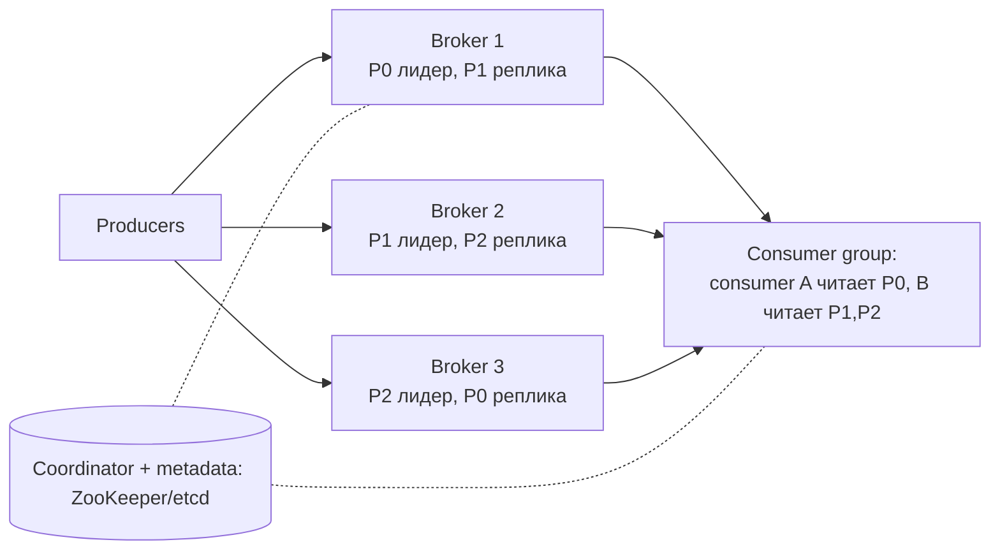

# Глава 4. Distributed Message Queue

> **Статус:** 🟨 конспект (по памяти, сверь цифры с книгой)  
> 🎮 [Симулятор этой главы](../../simulator/ch4/index.html)

## 🎯 Одной фразой
Проектируем очередь сообщений уровня Kafka: производители пишут, потребители читают, система не теряет данные и масштабируется по пропускной способности.

## 🧭 Карта решения
Требования → почему не очередь на БД → **append-only лог (WAL)** → **топики и партиции** → **consumer groups + offset + координатор** → **батчинг** → **репликация (ISR)** → семантики доставки

**Сюжет главы:** каждый шаг ответ на ограничение предыдущего. Лог быстр, но одна машина, значит партиции. Партиции есть, но кто читает какую, значит consumer groups и координатор. Машины падают, значит репликация, а она замедляет, значит настраиваем acks.

## 1. Требования
- Producers пишут, consumers читают; сообщение можно прочитать повторно (в отличие от классической очереди).
- **Порядок** внутри партиции; хранение до ~2 недель.
- Настраиваемая семантика доставки: **at-most-once / at-least-once / exactly-once**.
- Настраиваемый баланс: **высокий throughput** (батчи) или **низкая задержка**.

## 2. Архитектура

## 3. Путь решения: проблема → решение → эффект

### Шаг 1. Где хранить сообщения
- **🔴 Проблема:** очередь поверх БД (INSERT и SELECT FOR UPDATE) упирается в блокировки и случайный I/O. Тысячи сообщений в секунду уже предел.
- **🟢 Решение:** **append-only лог (WAL)**: сообщения только дописываются в конец сегмента, читаются последовательно по offset. Старые сегменты удаляются целиком по retention.
- **📈 Что улучшилось:** пропускная способность на порядки: последовательный диск и кэш страниц ОС быстрее случайного доступа.
- **⚖️ Цена:** нет сложных запросов, только чтение с позиции.
- **🗣️ Для интервью:** «Лог на диске быстрее, потому что пишем и читаем последовательно».

### Шаг 2. Одна машина не вытянет: партиции
- **🔴 Проблема:** один лог лежит на одной машине, масштабировать некуда.
- **🟢 Решение:** топик делится на **партиции**, каждая лог на своём брокере. Сообщения с одним ключом попадают в одну партицию.
- **📈 Эффект:** запись и чтение масштабируются горизонтально.
- **⚖️ Цена:** порядок гарантирован **только внутри партиции**; «горячие» ключи перегружают одну партицию; уменьшить число партиций трудно.

### Шаг 3. Кто какую партицию читает
- **🔴 Проблема:** несколько consumers одной задачи не должны читать одно и то же и не должны мешать друг другу.
- **🟢 Решение:** **consumer group**. Каждая партиция читается одним consumer-ом группы. **Offset** запоминает позицию. **Координатор** отслеживает участников (heartbeat) и перераспределяет партиции (**rebalance**).
- **📈 Эффект:** параллельное чтение без дублей, разные группы читают независимо.
- **⚖️ Цена:** consumers ≤ партиций (лишние простаивают), rebalance временно останавливает чтение.
- **🗣️ Для интервью:** «Партиция читается одним consumer-ом в группе, поэтому параллелизм ограничен числом партиций».

### Шаг 4. Throughput против latency: батчинг
- **🔴 Проблема:** каждое сообщение отдельным вызовом дорого.
- **🟢 Решение:** **батчи** на producer, брокере и consumer; zero-copy чтение.
- **📈 Эффект:** throughput в разы выше.
- **⚖️ Цена:** растёт задержка (ждём заполнения пачки) и риск потерять буфер при падении клиента. Это ручка настройки.

### Шаг 5. Брокеры падают: репликация
- **🔴 Проблема:** падение брокера означает потерю партиции.
- **🟢 Решение:** у партиции **лидер и фолловеры** на разных брокерах; **ISR** набор реплик, успевающих за лидером. Настройка **acks**: 0 (не ждём), 1 (лидер), all (все ISR).
- **📈 Эффект:** отказоустойчивость и сохранность данных; при падении лидера выбирается реплика из ISR.
- **⚖️ Цена:** диск ×3, сеть, запись медленнее. acks=all надёжнее, но задержка выше.

### Шаг 6. Семантики доставки
- **At-most-once:** commit offset до обработки (возможна потеря).
- **At-least-once:** commit после обработки (возможны дубли, значит consumer идемпотентный).
- **Exactly-once:** идемпотентный producer + транзакции/атомарный commit; самый дорогой вариант.

### Шаг 7. Push или pull
- **🔴 Проблема:** кто задаёт темп чтения, брокер или потребитель?
- **Push:** брокер шлёт сам. Задержка минимальная, но медленного потребителя заваливает, а размер пачки брокер не угадает.
- **🟢 Решение (книга):** **pull**: потребитель сам просит следующую пачку с нужного offset. Темп задаёт он, пачки получаются крупными, отставший догоняет без вреда для остальных.
- **⚖️ Цена:** при пустой партиции потребитель опрашивает впустую. Лечится **long polling**: брокер держит запрос, пока не появятся данные или не выйдет таймаут.

### Шаг 8. Что считается записанным: high watermark
- **🔴 Проблема:** лидер записал сообщение, реплики ещё нет. Если отдать его потребителю, а лидер упадёт, сообщение исчезнет: потребитель видел то, чего «не было».
- **🟢 Решение:** у партиции есть **high watermark**: самый большой offset, который уже есть у всех реплик из ISR. Потребитель читает только до него. Сообщение выше границы ещё не подтверждено.
- **⚖️ Цена:** задержка между записью и доступностью для чтения равна времени репликации. Реплика, отставшая больше порога, выпадает из ISR, чтобы не держать границу.

### Шаг 9. Хранение и удаление
- Партиция это набор **сегментов**: в активный дописывают, остальные закрыты на чтение. Удаление это стирание старых сегментов целиком по сроку (например, две недели) или по размеру: никаких правок в середине файла.
- Сообщение: ключ, значение, топик, партиция, offset, время, размер, CRC. Формат одинаков у продюсера, брокера и потребителя, поэтому данные идут без перекодирования (**zero-copy**).
- **Сжатие лога** (log compaction): для ключа хранится только последнее значение. Нужно, когда топик это состояние, а не поток событий.

### Шаг 10. Метаданные и координация
- **ZooKeeper** (или etcd, в новых версиях Kafka встроенный KRaft) хранит список живых брокеров, план размещения реплик и выбирает **контроллер**. Контроллер назначает лидеров партиций.
- Состояние потребителей (offset каждой группы по каждой партиции) лежит отдельно: читается часто, меняется постоянно, требует согласованности.

### Шаг 11. Рост кластера
- **Новый брокер:** контроллер добавляет его как реплику части партиций, тот догоняет лидеров, после чего лишние реплики убирают. Данные не теряются, потому что старая реплика жива, пока новая не догнала.
- **Больше партиций:** старые сообщения остаются где были, новые идут во все партиции. Данные переносить не надо, но сообщения с одним ключом теперь могут попасть в другую партицию: порядок по ключу на стыке нарушается.
- **Меньше партиций:** партицию перестают наполнять и убирают только после срока хранения, когда из неё всё дочитано.

### Шаг 12. Что добавляют поверх
- **Отложенные сообщения:** временное хранилище плюс таймер (иерархическое колесо таймеров); по сроку сообщение уходит в целевой топик.
- **Фильтрация:** метка (tag) в метаданных сообщения. Брокер фильтрует по ней, не разбирая тело.

## 4. Паттерны
Append-only log · Партиционирование · Consumer groups · Репликация leader/follower · Батчинг · Идемпотентность

**Шпаргалки к главе:** [репликация](../../cheatsheets/theory.md#4-репликация) · [гарантии доставки](../../cheatsheets/theory.md#9-гарантии-доставки) · [backpressure](../../cheatsheets/resilience.md#backpressure)

## 5. Вопросы для повторения

Почему лог на диске быстрее БД для очереди?

Последовательный I/O и кэш страниц ОС; нет блокировок и случайных записей.

Почему порядок гарантируется только внутри партиции?

Разные партиции лежат на разных брокерах и пишутся независимо.

Почему consumers в группе не больше партиций?

Партицию читает ровно один consumer группы: лишние простаивают.

Что такое ISR и acks=all?

ISR реплики, успевающие за лидером. acks=all значит запись подтверждена всеми ISR: надёжнее, но дольше.

Как получить at-least-once и что с дублями?

Commit offset после обработки. Дубли возможны, поэтому обработка должна быть идемпотентной.

Чем поток отличается от очереди?

Сообщение не удаляется после чтения: хранится по retention, читается повторно и несколькими группами.

Как устроено хранение?

Партиция это журнал только на дозапись, нарезанный на сегменты. Старые сегменты удаляются целиком.

Зачем пачки и как выбрать размер?

Меньше запросов и системных вызовов. Больше пачка, выше пропускная способность и задержка.

Push или pull?

Pull: потребитель читает в своём темпе. Long polling убирает пустые запросы.

Как работает ребалансировка?

Координатор группы следит за heartbeat. При вступлении или пропаже потребителя лидер группы составляет новый план, координатор раздаёт.

Что делает ZooKeeper?

Метаданные и план реплик, список живых брокеров, выбор контроллера. Контроллер назначает лидеров.

Как добавить партиции?

Без переноса: старые данные дочитываются и уходят по retention, новые идут во все партиции.

Как сделать отложенные сообщения?

Временное хранилище и иерархическое колесо таймеров, по сроку сообщение уходит в целевой топик.

## 6. Мои заметки
- …
