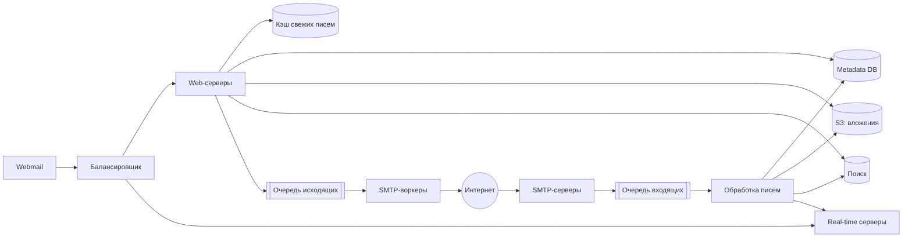

# Глава 8. Distributed Email Service

> **Статус:** 🟨 конспект (собран по данным симулятора, сверь цифры с книгой)  
> 🎮 [Симулятор этой главы](../../simulator/ch8/index.html)

## 🎯 Одной фразой
Почта масштаба Gmail: миллиард ящиков, письма приходят из всего интернета по SMTP, читают их в браузере. Главные решения главы: **очереди между приёмом и обработкой**, **wide-column NoSQL с разделом по `user_id`** и **денормализация под фильтр непрочитанных**.

## 🧭 Карта решения
Требования → оценка (100 тыс. отправок/с, 730 ПБ метаданных в год) → три протокола (HTTPS, WebSocket, SMTP) → web-серверы и real-time серверы → **очередь исходящих и очередь входящих** → Metadata DB по `user_id` → вложения в S3 → поиск → спам и вирусы → непрочитанные → сбой узла → повторы доставки → доставляемость

**Сюжет главы:** на обоих концах стоят чужие серверы, медленные и ненадёжные, а письмо после ответа «принято» терять нельзя. Поэтому всё, что касается внешнего мира, идёт через очередь.

## 1. Требования и оценка
- Отправить и получить письмо; список писем папки и само письмо; фильтр «только непрочитанные»; поиск по теме, отправителю и телу; спам и вирусы.
- NFR: надёжность (письмо не теряется), доступность, масштаб до миллиарда, расширяемость.
- Не делаем: IMAP и POP для внешних клиентов, календарь, сквозное шифрование.
- 1 млрд пользователей × 10 отправок в день ÷ 10⁵ с = **≈ 100 тыс. отправок/с**.
- Получает человек 40 писем в день: **≈ 460 тыс. входящих/с**, около половины это спам.
- Метаданные: 1 млрд × 40 писем × 365 дней × 50 КБ = **730 ПБ в год**.
- Вложения: 20% писем × 500 КБ = **1460 ПБ в год**.
- **Вывод:** одна реляционная БД не подходит ни по объёму, ни по записи; вложения нельзя держать в БД.

## 2. API и данные
- `POST /v1/messages`: отправить (ответ 202, доставка асинхронная). `POST /v1/attachments`: загрузить вложение.
- `GET /v1/folders`, `GET /v1/folders/{id}/messages`, `GET /v1/messages/{id}`, `PATCH /v1/messages/{id}` (прочитано, папка).
- `GET /v1/search`. `WS /v1/realtime`: новые письма сразу. SMTP на порту 25: приём из интернета по MX-записи.
- Metadata DB (wide-column, раздел `user_id`):
  - `folders_by_user`: папки ящика одним запросом.
  - `emails_by_folder`: строки списка, свежие первыми, без тела.
  - `emails_by_user`: письмо целиком.
  - `unread_emails` и `read_emails`: денормализация под фильтр.
- Вложения в объектном хранилище, в письме только ссылка. Поиск в отдельном индексе с маршрутизацией по `user_id`.

**Почему NoSQL:** сотни ПБ и сотни тысяч записей в секунду, запросы почти всегда в пределах одного ящика. Платим отсутствием JOIN и денормализацией. **Почему `user_id`:** весь ящик на одном узле. `email_id` даёт scatter-gather на каждый список, дата даёт горячий узел.

## 3. Архитектура

**Отправка:** web-сервер проверяет письмо, пишет в «Отправленные», кладёт в очередь исходящих и отвечает 202. SMTP-воркеры проверяют на спам и вирусы и доставляют наружу.
**Приём:** SMTP-сервер проверяет политику, кладёт в очередь входящих и отвечает 250. Воркеры фильтруют спам и вирусы, пишут в БД, S3 и индекс, а онлайн-получателю шлют событие по WebSocket.

## 4. Путь решения: проблема → решение → эффект

### Шаг 1. Чужой сервер отвечает минутами
- **🔴 Проблема:** отправка прямо из web-сервера держит соединение, пока чужой сервер думает. Пользователь ждёт, серверы заняты.
- **🟢 Решение:** **очередь исходящих**: web-сервер пишет письмо и сразу отвечает 202, доставляют SMTP-воркеры.
- **📈 Что улучшилось:** ответ пользователю не зависит от получателя; воркеры масштабируются отдельно.
- **⚖️ Цена:** «отправлено» ещё не значит «доставлено»; нужен мониторинг размера очереди.
- **🗣️ Для интервью:** «Всё, что касается чужих серверов, асинхронно».

### Шаг 2. Когда отвечать 250
- **🔴 Проблема:** ответ 250 по SMTP значит «письмо теперь наше», отправитель его удалит. Если ответить до записи, письмо можно потерять.
- **🟢 Решение:** отвечаем 250 только после надёжной записи в **очередь входящих**. Тяжёлая обработка идёт после.
- **⚖️ Цена:** очередь должна быть с репликацией; в спам-волну она растёт.

### Шаг 3. Push вместо опроса
- **🔴 Проблема:** сто миллионов клиентов онлайн, опрос каждые 30 секунд это миллионы пустых запросов в секунду.
- **🟢 Решение:** **WebSocket** на отдельных real-time серверах. Web-серверы без состояния, real-time держат соединения и знают, кто подключён.
- **⚖️ Цена:** серверы с состоянием: сложнее балансировка и выкатка.

### Шаг 4. Спам и вирусы
- **🔴 Проблема:** около половины входящих это спам, бывают вирусы; спам-волна от ботнета умножает поток.
- **🟢 Решение:** **ML-классификатор и антивирус в воркерах** после очереди, плюс SPF, DKIM и DMARC. На волну: фильтр по репутации IP перед SMTP-серверами.
- **⚖️ Цена:** воркеры обработки тяжелее.
- **🔀 Альтернативы:** правила и чёрные списки дёшевы, но новые рассылки проходят. Проверка в SMTP-сервере задерживает ответ 250.

### Шаг 5. Фильтр «только непрочитанные»
- **🔴 Проблема:** NoSQL отвечает по ключу. `WHERE is_read = false` читает весь ящик, а в нём сотни тысяч писем.
- **🟢 Решение:** **две таблицы** `read_emails` и `unread_emails` с одинаковым ключом. «Прочитано» это DELETE из одной и INSERT в другую одной пачкой.
- **🔀 Альтернативы:** вторичный индекс по колонке с двумя значениями огромный и утяжеляет каждую запись.
- **🗣️ Для интервью:** «В NoSQL запросы проектируют до таблиц: под каждый запрос своя таблица».

### Шаг 6. Сбой узла с ящиком
- **🔴 Проблема:** узлов сотни, какой-то падает каждый день. Если писать в любую живую копию, копии ящика расходятся.
- **🟢 Решение (книга):** **один primary на ящик**, при сбое failover.
- **⚖️ Цена:** ящик недоступен, пока выбирают новый primary. Согласованность важнее доступности на это время.
- **🔀 Альтернативы:** кворум R + W > N доступнее, но каждый запрос ждёт двух копий, а при разрыве сети конфликты возможны.

### Шаг 7. Сервер получателя не принимает
- **🔴 Проблема:** чужой сервер перегружен или просит подождать (4xx, greylisting).
- **🟢 Решение:** **очередь повторов** с растущей паузой: 1, 5, 30 минут и до 3 дней. Не получилось: письмо о недоставке (bounce).
- **🔀 Альтернативы:** повтор в цикле внутри воркера занимает воркер и партицию, основная очередь встаёт.

### Шаг 8. Наши письма попадают в спам
- **🔴 Проблема:** получатели сами фильтруют входящие. Один спамер среди наших пользователей портит репутацию IP всем.
- **🟢 Решение:** SPF, DKIM, DMARC; выделенные IP и их прогрев; рассылки отдельно от личной почты; быстрый бан спамеров; обработка bounce и жалоб.
- **🗣️ Для интервью:** «Доставляемость это репутация, а не только подпись».

### Шаг 9. Поиск
- **🟢 Решение:** отдельный индекс. Elasticsearch с маршрутизацией по `user_id`, наполнение через Kafka.
- **🔀 Альтернатива:** свой индекс на LSM рядом с письмами дешевле на запись на масштабе Gmail, но это своя разработка.

## 5. Паттерны
Очередь между приёмом и обработкой · Раздел по ключу запроса · Денормализация под запрос · Один лидер на раздел · Повторы с паузой и DLQ · Объектное хранилище для BLOB · Push по WebSocket

## 6. Вопросы для повторения

Какие протоколы и где?

SMTP между почтовыми серверами, HTTPS между webmail и web-серверами, WebSocket для новых писем. IMAP и POP в книге не проектируются.

Почему NoSQL и какой ключ раздела?

Сотни ПБ в год и сотни тысяч записей в секунду, запросы в пределах ящика. Ключ user_id: список папки и письмо читаются из одного раздела.

Как сделать фильтр непрочитанных?

Две таблицы read_emails и unread_emails. Отметка «прочитано» переносит строку одной пачкой.

Что происходит при приёме письма?

SMTP-сервер кладёт письмо в очередь входящих и отвечает 250. Воркеры фильтруют спам и вирусы, пишут в БД, S3 и индекс, шлют событие по WebSocket.

Что выбрать при сбое узла и чем платим?

Один primary на ящик. Копии не расходятся, но ящик недоступен на время failover.

Как обеспечить доставляемость?

SPF, DKIM, DMARC, выделенные и прогретые IP, рассылки отдельно, бан спамеров, обработка bounce и жалоб.

Какое новое требование сломает дизайн?

Сквозное шифрование: сервер не видит текст, ломаются поиск и фильтр спама.

## 7. Мои заметки
- …
