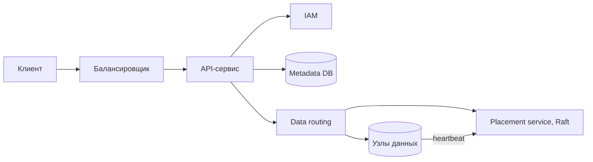

# Глава 9. S3-like Object Storage

> **Статус:** 🟨 конспект (собран по данным симулятора, сверь цифры с книгой)  
> 🎮 [Симулятор этой главы](../../simulator/ch9/index.html)

## 🎯 Одной фразой
Объектное хранилище в стиле S3: 100 ПБ в год, шесть девяток надёжности. Главные решения главы: **метаданные отдельно от байтов**, **домены отказа и erasure coding** и **склейка мелких объектов в большие файлы**.

## 🧭 Карта решения
Требования → оценка (0,68 млрд объектов, размер кластера задают диски) → API как у S3 → **метаданные и данные врозь** → Data routing, Placement на Raft, узлы данных → сколько копий и где → когда подтверждать запись → мелкие объекты → контрольные суммы → листинг при шардах → версии → multipart → сборка мусора

**Сюжет главы:** запросов мало, а данных очень много. Узлы считают по объёму дисков, а не по QPS, и почти все решения про то, как не потерять байты и не переплатить за место.

## 1. Требования и оценка
- Создать бакет; загрузить и скачать объект; листинг по префиксу; версии; большие файлы (до нескольких ГБ) и много мелких.
- NFR: 100 ПБ в год, надёжность данных **шесть девяток**, доступность **четыре девятки**, эффективность хранения.
- Объектное хранилище против блочного и файлового: неизменяемые объекты по ключу в плоском пространстве имён. Дёшево и растёт без предела, но без правки по месту.
- Распределение: 20% мелких (< 1 МБ), 60% средних, 20% крупных (> 64 МБ). Диски заполнены на 40%.
- 100 ПБ × 0,4 = 40 ПБ данных; средний объект около 59 МБ, значит **≈ 0,68 млрд объектов**; по 1 КБ метаданных это **0,68 ТБ**.
- **Вывод:** метаданные помещаются в обычную шардированную БД, а кластер данных это тысячи узлов. Размер задают диски, сеть и IOPS, а не число запросов.

## 2. API и данные
- `PUT /{bucket}`, `PUT /{bucket}/{object}`, `GET /{bucket}/{object}`, `DELETE /{bucket}/{object}`.
- `GET /{bucket}?list-type=2&prefix=…`: листинг с пагинацией.
- Multipart: `POST ?uploads` → `PUT ?partNumber=N&uploadId=…` → `POST ?uploadId=…`.
- Metadata DB:
  - `bucket`: мало строк, один сервер с репликами.
  - `object`: имя → `object_id`, версии; шарды по `hash(bucket_name, object_name)`.
  - `object_listing`: то же, но шарды по `bucket_id` и сортировка по имени. Только для LIST.
- На узле данных: `object_mapping` (`object_id` → файл, смещение, размер) в SQLite.

## 3. Архитектура

**Загрузка:** API проверяет права в IAM и отдаёт байты в Data routing. Тот берёт UUID, спрашивает Placement о primary-узле, пишет на него, primary копирует на вторичные. После копий в Metadata DB появляется строка «имя → object_id».
**Чтение:** API находит `object_id` по имени, Data routing читает байты с любой копии.

## 4. Путь решения: проблема → решение → эффект

### Шаг 1. Метаданные и байты вместе
- **🔴 Проблема:** метаданные маленькие и изменяемые, данные огромные и неизменяемые. Одна система плохо делает и то и другое.
- **🟢 Решение:** **два хранилища**: Metadata DB и хранилище данных. Связь через `object_id`.
- **📈 Что улучшилось:** каждое масштабируется по-своему.
- **🗣️ Для интервью:** «Это как inode и блоки в файловой системе Unix».

### Шаг 2. Сколько копий
- **🔴 Проблема:** диск отказывает примерно раз в сто лет (AFR около 0,81%), но дисков тысячи: отказ каждый день.
- **🟢 Решение:** три копии дают 1 − 0,0081³ ≈ **шесть девяток**. Для основного объёма **erasure coding 8+4**: переживает потерю любых 4 кусков, лишнего места 50% вместо 200%, около 11 девяток.
- **⚖️ Цена EC:** CPU на чётность, запись и чтение с нескольких узлов, медленнее при отказах.
- **🗣️ Для интервью:** «Копии там, где важна задержка, EC там, где важна цена».

### Шаг 3. Где лежат копии
- **🔴 Проблема:** копии в одной стойке гибнут вместе. Расчёт девяток верен только для независимых отказов.
- **🟢 Решение:** Placement знает **карту кластера** (ДЦ, стойки, узлы) и кладёт копии в разные домены отказа, в идеале в разные зоны доступности.
- **⚖️ Цена:** запись дольше на пару мс.

### Шаг 4. Когда подтверждать запись
- **🔴 Проблема:** ответить можно после primary, после одной копии или после всех. Чем раньше, тем быстрее PUT и тем больше риск.
- **🟢 Решение:** после **всех копий**: любое чтение после ответа видит объект.
- **⚖️ Цена:** задержка самой медленной копии.
- **🔀 Альтернативы:** primary и одна копия быстрее, но чтение с третьей может не найти свежий объект.

### Шаг 5. Миллиарды мелких объектов
- **🔴 Проблема:** файл на объект: каждый занимает блок 4 КБ, кончаются inode, поиск в каталоге стоит лишних обращений к диску.
- **🟢 Решение:** **склейка в большие файлы**: объект дописывается в конец read-write файла, полный файл закрывается на чтение. Где лежит объект, хранит `object_mapping` в **SQLite на самом узле**.
- **🔀 Альтернативы:** RocksDB быстро пишет, но чтение проверяет несколько уровней, а чтений 95%. Общая БД мест добавляет поход в сеть на каждый запрос.

### Шаг 6. Тихая порча данных
- **🔴 Проблема:** диск или память иногда отдают не те байты и не сообщают об этом.
- **🟢 Решение:** **контрольная сумма** у объекта и у файла, сверка при чтении; не сошлась, читаем другую копию. Плюс фоновый обход (scrubbing) для редко читаемых данных.
- **⚖️ Цена:** обход занимает часть пропускной способности дисков.

### Шаг 7. Листинг при шардах
- **🔴 Проблема:** `object` разбита по `hash(bucket, object)`: объекты с префиксом `photos/` разбросаны по всем шардам, листинг это опрос всех.
- **🟢 Решение:** отдельная таблица **`object_listing`**, шардированная по `bucket_id` и отсортированная по имени: префикс читается диапазоном в одном шарде.
- **⚖️ Цена:** вторая запись на каждый PUT.

### Шаг 8. Версии
- **🔴 Проблема:** PUT по существующему имени и DELETE по ошибке уничтожают данные.
- **🟢 Решение:** **новая строка на версию**: та же пара бакет и имя, новый `object_id`, `object_version` типа TIMEUUID. DELETE вставляет delete marker.
- **⚖️ Цена:** старые версии занимают место.

### Шаг 9. Большие файлы
- **🔴 Проблема:** обрыв связи на 99% загрузки начинает её заново.
- **🟢 Решение:** **multipart upload**: `uploadId`, части параллельно, ETag на каждую, сборка по списку.
- **⚖️ Цена:** брошенные загрузки оставляют части, их убирает сборщик мусора.

### Шаг 10. Удаление и мусор
- **🔴 Проблема:** удалённые объекты остаются внутри больших файлов. Стирать кусок из середины на HDD дорого.
- **🟢 Решение:** **ленивое удаление и компакция**: пометка, затем сборщик копирует живые объекты из нескольких read-only файлов в новый, обновляет `object_mapping` одной транзакцией и стирает старые файлы.

### Что ещё держит дизайн
- **Placement на Raft из 5–7 узлов:** карта кластера переживает отказ части узлов. Узлы шлют heartbeat; нет его 15 секунд, узел считается упавшим, копии восстанавливаются.
- **Реляционная БД для метаданных:** нужна транзакция на `object` и листинг. NoSQL проще растёт, но таблицы разойдутся.

## 5. Паттерны
Разделение метаданных и данных · Домены отказа · Репликация против erasure coding · Лог-структурированное хранение и компакция · Денормализация под запрос · Контрольные суммы и scrubbing · Консенсус (Raft) для карты кластера · Ленивое удаление

## 6. Вопросы для повторения

Чем объектное хранилище отличается от блочного и файлового?

Блочное отдаёт диск блоками, файловое даёт каталоги и правку по месту. Объектное хранит неизменяемые объекты по ключу в плоском пространстве имён.

Откуда шесть девяток?

AFR диска около 0,81%. Три независимые копии теряются вместе с вероятностью 0,0081³ ≈ 5 × 10⁻⁷. Независимость дают разные домены отказа.

Копии или erasure coding?

EC 8+4 тратит 50% лишнего места вместо 200% и надёжнее, но требует CPU и читает с нескольких узлов. Копии для чувствительного к задержке.

Как узел хранит мелкие объекты?

Дописывает в большие файлы; object_mapping (файл, смещение, размер) лежит в SQLite на узле.

Как шардировать метаданные и как делать листинг?

object по hash(bucket_name, object_name): поиск по имени в один шард. Листинг в отдельной таблице по bucket_id.

Как освобождается место после удаления?

Пометка, затем компакция read-only файлов в новый и обновление object_mapping одной транзакцией.

Какое новое требование сломает дизайн?

Дописывание в объект: ломает неизменяемость, на которой держатся EC, контрольные суммы и склейка файлов.

## 7. Мои заметки
- …
