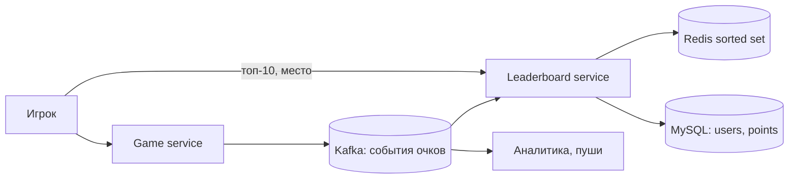

# Глава 10. Real-time Gaming Leaderboard

> **Статус:** 🟨 конспект (по памяти, сверь цифры с книгой)  
> 🎮 [Симулятор этой главы](../../simulator/ch10/index.html)

## 🎯 Одной фразой
Рейтинг месяца для мобильной игры: очко за победу, топ-10 и **место любого игрока среди миллионов за миллисекунды**. Главное решение главы: **sorted set в Redis** вместо `ORDER BY` в SQL, а потом его шардирование.

## 🧭 Карта решения
Требования → оценка (500 очков/с, пик 2500, 650 МБ) → API (очки шлёт **сервер**) → почему не SQL → **Redis sorted set** → MySQL для профилей и истории → Kafka, если очки нужны многим → **×100: шарды по диапазонам очков** → равные очки → восстановление

**Сюжет главы:** нагрузка скромная, трудность в структуре данных. Место игрока нужно знать мгновенно и после каждой победы, а пересчитывать миллионы строк на каждый запрос нельзя.

## 1. Требования и оценка
- Очко за победу; топ-10; место конкретного игрока (бонус: 4 выше и 4 ниже); рейтинг месяца, каждый месяц с нуля; равные очки дают одинаковое место.
- NFR: обновление в реальном времени, масштабируемость, доступность, надёжность.
- 5 млн DAU, 25 млн MAU, 10 игр в день на игрока.
- 5 млн ÷ 10⁵ с = **50 игроков/с**; × 10 игр = **500 очков/с**, пик ×5 = **2500/с**.
- Топ-10 грузится при входе в игру, раз в день: **≈ 50 QPS**.
- Память: 25 млн × (24 Б user_id + 2 Б очки) = **650 МБ**. Один Redis, даже с запасом под skip list.

## 2. API и данные
- `POST /v1/scores` `{user_id, points}`: **внутренний**, его зовёт только Game service.
- `GET /v1/scores`: топ-10 `{data: [{user_id, user_name, rank, score}], total}`.
- `GET /v1/scores/{user_id}`: `{user_info: {user_id, score, rank}}`.
- Redis: ключ `leaderboard_<месяц>` (например `leaderboard_feb_2021`), член это user_id, score это очки.
  - `ZINCRBY leaderboard_feb_2021 1 'mary1934'`: победа.
  - `ZREVRANGE leaderboard_feb_2021 0 9 WITHSCORES`: топ-10.
  - `ZREVRANK leaderboard_feb_2021 'mary1934'`: место. Соседи: `ZREVRANGE` от ранга −4 до +4.
- MySQL: `users` (имя, аватар для топ-10) и `points` (user_id, очки, время каждой победы).

## 3. Архитектура

Победа: Game service → Leaderboard service → `ZINCRBY` в Redis и строка в `points`. Чтение: клиент → Leaderboard service → `ZREVRANGE` / `ZREVRANK`, имена топ-10 из `users`. Kafka нужна, только если очки читают ещё аналитика и пуши.

## 4. Путь решения: проблема → решение → эффект

### Шаг 1. Кто начисляет очки
- **🔴 Проблема:** клиент сам шлёт «я выиграл», запрос легко подделать (man-in-the-middle).
- **🟢 Решение:** очки начисляет **Game service**: он ведёт матч и знает победителя. API записи внутренний.
- **⚖️ Цена:** лишний переход между сервисами.
- **🗣️ Для интервью:** «Клиент только читает рейтинг, пишет сервер».

### Шаг 2. SQL не держит ранг
- **🔴 Проблема:** `ORDER BY score DESC` и подсчёт «у скольких больше» на 25 млн строк это перебор таблицы на каждый запрос места. Кэшировать нельзя: очки меняются каждую секунду.
- **🟢 Решение:** **Redis sorted set**: хэш member → score и skip list по score. Вставка, изменение и ранг за **O(log n)**.
- **📈 Что улучшилось:** место игрока за миллисекунды, обновление сразу после победы.
- **⚖️ Цена:** данные в памяти, нужна страховка.
- **🔀 Альтернативы:** SQL годится, если игроков мало или рейтинг считается раз в день.

### Шаг 3. Надёжность
- **🔴 Проблема:** Redis упал вместе с памятью.
- **🟢 Решение:** реплика Redis для отказа; таблица `points` в MySQL как источник истины: при полной потере рейтинг собирают заново, `ZINCRBY` по каждой победе месяца.
- **⚖️ Цена:** вторая запись на каждую победу.

### Шаг 4. Очки нужны не только рейтингу
- **🔴 Проблема:** аналитике и пушам тоже нужны события; прямые вызовы удлиняют и ломают начисление.
- **🟢 Решение:** **Kafka** между Game service и потребителями.
- **⚖️ Цена:** ещё один кластер; если потребитель один, Kafka не нужна.

### Шаг 5. Игроков в 100 раз больше
- **🔴 Проблема:** 500 млн DAU это **65 ГБ** и **250 тыс. обновлений/с**. Весь рейтинг это **один ключ**, а Redis Cluster делит ключи, а не один ключ.
- **🟢 Решение (книга):** **фиксированные диапазоны очков**, шард на диапазон. Топ-10 из верхнего шарда; место = ранг в своём шарде + число игроков в шардах выше. Кэш `user_id → очки`, чтобы знать шард; при переходе границы игрок переезжает.
- **🔀 Альтернатива:** **хэш по user_id** (16 384 слота Redis Cluster): запись делится, но топ-10 это scatter-gather со всех шардов, а точный ранг не узнать.
- **⚖️ Цена:** переезды между шардами, подбор границ под распределение очков. Память под снапшот (fork) при частой записи держат с запасом ×2.

### Шаг 6. Равные очки
- **🔴 Проблема:** при равном score Redis упорядочивает по member (user_id), для игрока это случайно.
- **🟢 Решение:** Redis hash `user_id → время последней победы`: при равных очках выше тот, кто набрал раньше.

### Другие варианты из книги
- **API Gateway + AWS Lambda** вместо своих серверов: масштаб сам, но холодный старт и привязка к облаку.
- **DynamoDB**: глобальный индекс с ключом `game#месяц#p{N}` (write sharding) и сортировкой по score. Топ-10 со всех партиций, место только процентилем («ты в топ-10%»).

## 5. Паттерны
Sorted set / skip list · Server-authoritative запись · Источник истины + перестраиваемый кэш · Шардирование по диапазону против хэша · Scatter-gather · Tie-break по времени

## 6. Вопросы для повторения

Сколько очков в секунду и сколько памяти?

50 игроков/с × 10 игр = 500, пик 2500. 25 млн × 26 Б = 650 МБ: один Redis. При ×100 уже 65 ГБ.

Почему не SQL?

Место игрока это перебор всех, у кого очков больше; кэш бесполезен, очки постоянно меняются.

Какие команды sorted set нужны?

ZINCRBY за победу, ZREVRANGE 0 9 для топ-10, ZREVRANK для места.

Почему фиксированные диапазоны, а не хэш?

Топ-10 лежит в одном шарде, а место считается как ранг в шарде плюс игроки выше. При хэше топ надо собирать со всех шардов, а точный ранг не узнать.

Как восстановить рейтинг?

Реплика Redis; если потеряно всё, пройти таблицу points за месяц и сделать ZINCRBY для каждой победы.

## 7. Мои заметки
- …
