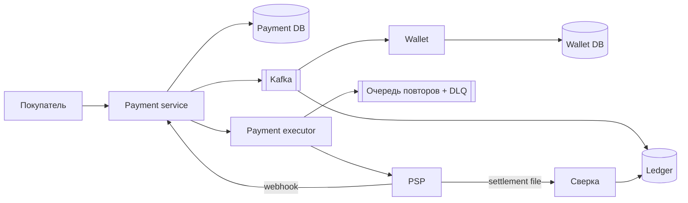

# Глава 11. Payment System

> **Статус:** 🟨 конспект (по памяти, сверь цифры с книгой)  
> 🎮 [Симулятор этой главы](../../simulator/ch11/index.html)

## 🎯 Одной фразой
Бэкенд платежей маркетплейса: приём оплаты картой через **PSP** (pay-in) и выплаты продавцам (pay-out). Нагрузка смешная, **10 TPS**; глава про **правильность**: ровно одно списание, ни одного потерянного платежа, каждый цент объясним по ledger и сверен с PSP.

## 🧭 Карта решения
Требования → оценка (10 TPS, одна БД) → API (сумма строкой, payment_order_id) → Payment service + executor + PSP → hosted payment page → webhook для долгих платежей → **повторы + ключ идемпотентности = exactly-once** → Kafka для wallet и ledger → **двойная запись** → **ежедневная сверка**

**Сюжет главы:** сеть и PSP падают посередине платежа. Как сделать, чтобы деньги списались ровно один раз и всё сошлось.

## 1. Требования и оценка
- Pay-in картой через PSP (Stripe, Adyen, PayPal), pay-out продавцам (сервис выплат вроде Tipalti), учёт и сверка.
- Не делаем: хранение карт (PCI DSS), свой процессинг, возвраты и чарджбэки.
- NFR: надёжность и отказоустойчивость, сверка между внутренними и внешними системами. Скорость и масштаб второстепенны.
- 1 млн платежей в день ÷ 10⁵ с = **10 TPS**. Одна реляционная БД держит тысячи: шардирование не нужно.

## 2. API и данные
- `POST /v1/payments` `{buyer_info, checkout_id, credit_card_info, payment_orders: [{seller_account, amount, currency, payment_order_id}]}`. **Сумма строкой**: float теряет копейки.
- `GET /v1/payments/{id}`: статус.
- `payment_event` (checkout_id, buyer_info, credit_card_info = токен, is_payment_done).
- `payment_order` (payment_order_id = **ключ идемпотентности**, checkout_id, amount, currency, status `NOT_STARTED → EXECUTING → SUCCESS | FAILED`, ledger_updated, wallet_updated).
- БД **реляционная**: ACID и проверенная стабильность важнее скорости.

## 3. Архитектура

Payment service сохраняет событие, executor отправляет каждый заказ в PSP, итог приходит webhook. После успеха Wallet увеличивает баланс продавца, Ledger пишет проводки. Раз в день сверка.

## 4. Путь решения: проблема → решение → эффект

### Шаг 1. Номера карт
- **🔴 Проблема:** своя форма карты тянет всю систему в зону PCI DSS.
- **🟢 Решение:** **hosted payment page** PSP. Регистрируем платёж в PSP с UUID (nonce), получаем токен, клиент вводит карту в форме PSP, PSP возвращает на redirect URL и зовёт webhook.
- **⚖️ Цена:** меньше контроля над видом формы.

### Шаг 2. PSP отвечает не сразу
- **🔴 Проблема:** 3-D Secure и банк отвечают секундами и минутами; держать соединение значит висящие потоки и обрывы.
- **🟢 Решение:** сразу «в обработке», статус EXECUTING, итог через **webhook**, клиент спрашивает статус. Webhook идемпотентен.

### Шаг 3. Таймаут: прошло или нет?
- **🔴 Проблема:** вызов PSP оборвался, итог неизвестен.
- **🟢 Решение:** **повтор** (at-least-once). Стратегии: сразу, фиксированный интервал, растущий, **экспоненциальная задержка**, отмена. Временные ошибки в **очередь повторов**, исчерпанные в **dead letter queue**. Невосстановимые ошибки не повторяем.

### Шаг 4. Повтор не должен списать дважды
- **🔴 Проблема:** двойной клик, повтор после таймаута, когда первый вызов на деле прошёл.
- **🟢 Решение:** **ключ идемпотентности** (at-most-once): заголовок `Idempotency-Key` = payment_order_id, в БД уникальный ключ; тот же ключ уходит в PSP.
- **📈 Итог:** exactly-once = at-least-once + at-most-once.

### Шаг 5. Wallet и ledger
- **🔴 Проблема:** синхронные вызовы связывают платёж со всеми потребителями.
- **🟢 Решение:** событие в **Kafka**, Wallet и Ledger читают сами.
- **⚖️ Цена:** запись в БД и в Kafka это две записи. **Расширение:** transactional outbox (событие в той же транзакции, публикует релей или CDC).

### Шаг 6. Учёт
- **🟢 Решение:** **двойная запись**: каждая операция это дебет одного счёта и кредит другого на одну сумму, сумма всех проводок 0. Только добавление, ошибки правятся новой проводкой.

### Шаг 7. Сверка
- **🔴 Проблема:** системы расходятся: ошибки PSP и банков, потерянные webhook, баги.
- **🟢 Решение:** раз в день **settlement file** PSP сравнивается с ledger, wallet с ledger. Расхождения: исправимые автоматически; исправимые финансовой командой по очереди; неклассифицируемые.

### Другое из книги
- Согласованность реплик: статус читать с primary или взять БД на консенсусе (CockroachDB, YugabyteDB).
- Безопасность: HTTPS, шифрование, rate limiting, токены, 3-D Secure и антифрод.

### Расширения (не из книги)
- **Temporal / Step Functions** вместо своего executor: шаги, таймеры и повторы переживают падения.
- **Второй PSP** с маршрутизацией: сбой одного не останавливает оплату; ключ идемпотентности тот же.

## 5. Паттерны
Idempotency key · Retry с экспоненциальной задержкой · Dead letter queue · Webhook · Двойная запись · Reconciliation · Transactional outbox

## 6. Вопросы для повторения

Сколько TPS и что из этого следует?

1 млн в день ÷ 10⁵ = 10 TPS: одна реляционная БД, говорим о правильности.

Как добиться exactly-once?

Повторы (at-least-once) плюс ключ идемпотентности в БД и в PSP (at-most-once).

Зачем hosted payment page?

Номер карты уходит в PSP мимо нас, у нас только токен: вне зоны PCI DSS.

Зачем сверка, если всё идемпотентно?

Внешние системы всё равно расходятся с нами. Сверка с файлом расчётов ловит всё раз в сутки.

## 7. Мои заметки
- …
