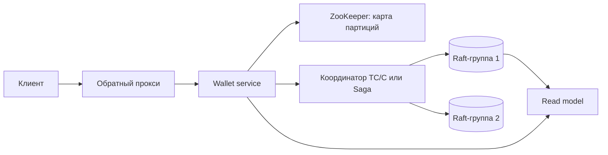

# Глава 12. Digital Wallet

> **Статус:** 🟨 конспект (по памяти, сверь цифры с книгой)  
> 🎮 [Симулятор этой главы](../../simulator/ch12/index.html)

## 🎯 Одной фразой
Кошелёк на **1 млн переводов в секунду**: счета разнесены по тысячам машин, каждый перевод трогает два из них, и деньги не должны ни исчезать, ни появляться. Плюс **воспроизводимость** баланса для аудита.

## 🧭 Карта решения
Требования → оценка (**2 млн операций/с → 2 000 узлов**) → решение 1: Redis + ZooKeeper (не атомарно) → решение 2: реляционные шарды + **2PC / TC/C / Saga** → решение 3: **event sourcing** → быстрый ES (локальные файлы, mmap, RocksDB, снапшоты) → **Raft-группы** → CQRS и обратный прокси

## 1. Требования и оценка
- Перевод между двумя кошельками; 1 млн TPS; надёжность 99,99%; транзакционность; воспроизводимость (баланс на любой момент переигрыванием).
- Не делаем: пополнение и вывод на карту (это глава 11), валюты.
- Перевод = 2 операции → **2 млн операций/с**. Узлы: 100 TPS/узел → 20 000; 1 000 → **2 000**; 10 000 → 200.

## 2. API и данные
- `POST /v1/wallet/balance_transfer` `{from_account, to_account, amount (строка), currency, transaction_id (UUID)}`.
- balance (account, amount, reserved); phase_status координатора; события (seq, account, delta).

## 3. Архитектура (итог книги)

## 4. Путь решения

### Решение 1. Redis в памяти
- Балансы в шардах Redis, карта шардов в ZooKeeper, Wallet service без состояния.
- **🔴 Проблема:** списание и зачисление на двух узлах **не атомарны**; память ненадёжна.

### Решение 2. Распределённые транзакции
- Реляционные шарды: внутри шарда ACID, между шардами координатор.
- **2PC:** prepare → commit; блокировки весь протокол, координатор единая точка отказа.
- **TC/C:** Try (резерв), Confirm (применить) или Cancel (вернуть). Каждая фаза локальная транзакция, фазы параллельно. **Таблица статусов фаз**; Cancel раньше Try (out of order) участник запоминает.
- **Saga:** шаги по порядку, компенсации в обратном порядке; оркестрация или хореография. Проще, но медленнее.
- **⚖️ Цена:** согласованность в конце: между фазами деньги «в пути».

### Решение 3. Event sourcing
- **Команда → (проверка state machine) → события → состояние.** События неизменны и упорядочены, автомат детерминирован → баланс воспроизводим.
- **CQRS:** пишет один автомат, read-only автоматы строят представления для чтения.
- **Быстро:** команды и события в локальных файлах через **mmap**, состояние в **RocksDB**, **снапшоты**.
- **Надёжно:** список событий реплицируется **Raft** на 3 узла; подтверждение после записи большинством.
- **Масштаб:** партиции по счёту, каждая Raft-группа; перевод между партициями через TC/C или Saga.
- **Ответ клиенту:** **обратный прокси** держит запрос и отвечает, когда автомат опубликует событие (push вместо опроса).

### Расширения (не из книги)
- **Горячий счёт:** крупный продавец получает 10% переводов, его партиция становится потолком системы. Делим на **суб-счета**, сумма сводится периодически.
- **Spanner / CockroachDB:** транзакции через шарды встроены, свой координатор не нужен; запись медленнее, истории событий нет.
- **TigerBeetle:** БД для двойной записи с пакетами и двухфазными переводами; один кластер без шардов (по заявлению авторов около миллиона переводов в секунду).

## 5. Паттерны
Шардирование по ключу · 2PC · TC/C · Saga · Event sourcing · CQRS · Raft · Снапшоты · mmap

## 6. Вопросы для повторения

Сколько узлов?

1 млн × 2 = 2 млн операций/с; при 1 000 TPS на узел 2 000 узлов.

Чем TC/C отличается от 2PC?

В TC/C каждая фаза локальная транзакция без блокировок между фазами, откат через Cancel. 2PC держит блокировки весь протокол.

TC/C или Saga?

TC/C шлёт фазы параллельно, Saga строго по порядку. Обе с компенсациями и согласованностью в конце.

Как event sourcing даёт воспроизводимость?

Состояние выводится детерминированным применением неизменных событий: переигрываем до нужного момента.

## 7. Мои заметки
- …
