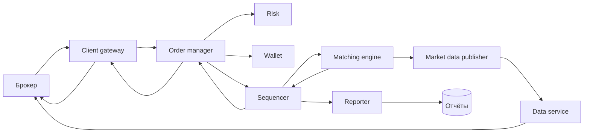

# Глава 13. Stock Exchange

> **Статус:** 🟨 конспект (по памяти, сверь цифры с книгой)  
> 🎮 [Симулятор этой главы](../../simulator/ch13/index.html)

## 🎯 Одной фразой
Электронная биржа: лимитные заявки, matching engine, рыночные данные. Объём скромный (**215 тысяч заявок/с в пик**), трудность в **задержке**: критический путь за микросекунды и стабильный **p99**.

## 🧭 Карта решения
Требования → оценка (43 тыс./с, пик 215 тыс.) → три потока (торговля, рыночные данные, отчёты) → **sequencer** и **matching engine** → стакан за O(1) → **один сервер + mmap** → application loop на прибитом ядре → горячий-тёплый + **Raft** → multicast и колокация → защита от DDoS

## 1. Требования и оценка
- Лимитные заявки, отмена, исполнения в реальном времени, стакан и свечи, проверка рисков (например, не больше 1 млн акций Apple в день) и средств. 100 символов, десятки тысяч пользователей.
- NFR: доступность 99,99%, отказоустойчивость, задержка в миллисекундах с упором на p99, безопасность (KYC, DDoS).
- 1 млрд заявок ÷ (6,5 ч × 3600 с) ≈ **43 000/с**, пик ×5 ≈ **215 000/с**.

## 2. API и данные
- `POST /v1/order` `{symbol, side, price, orderType: limit, quantity}`.
- `GET /v1/execution?symbol&orderId&startTime&endTime`.
- `GET /marketdata/orderBook/L2?symbol&depth`, `GET /marketdata/candles?symbol&resolution&startTime&endTime`.
- Product, Order, Execution, стакан (в памяти), свечи. В жизни брокеры говорят по FIX.

## 3. Архитектура

- **Торговый поток** (критический путь): gateway → order manager (risk, wallet) → sequencer → matching → исполнения обратно.
- **Рыночные данные:** matching → publisher (стакан, свечи) → data service → брокеры.
- **Отчёты:** reporter читает event store, пишет в БД. Вне критического пути.

## 4. Путь решения

### Шаг 1. Matching engine и стакан
- Уровни цены, на каждом **двусвязный список** заявок по времени, **map order_id → узел**: добавить, отменить, исполнить за **O(1)**. Алгоритм FIFO (вариант FIFO с LMM).
- **Детерминизм:** те же события → те же сделки. Основа восстановления и резерва.

### Шаг 2. Sequencer
- Номер каждой входящей заявке и исходящему исполнению: единый порядок, честность, переигрывание, ровно один раз. Последовательность событий это **event store**.

### Шаг 3. Задержка
- **🔴 Проблема:** микросервисы по сети: каждый переход ~250 мкс (круг ~500 мкс), диск ещё дольше.
- **🟢 Решение:** компоненты критического пути **на одном сервере**, общение через event store на **mmap**. Каждый компонент это **application loop**: один поток, прибит к ядру CPU, без блокировок и переключений контекста.
- **📈 Итог:** десятки микросекунд и p99 близко к медиане.

### Шаг 4. Отказоустойчивость
- **Горячий-тёплый:** тёплый движок читает тот же поток событий, подхватывает за доли секунды. Детектор по heartbeat.
- Смерть сервера: event store реплицируется **Raft** на 5 серверов, новый лидер за секунды, RPO ≈ 0. Снапшоты ускоряют подъём.

### Шаг 5. Рыночные данные и честность
- Publisher на кольцевых буферах. Рассылка **надёжным UDP multicast**: все получают одновременно. **Колокация** с одинаковыми кабелями.

### Шаг 6. Безопасность
- Публичные сервисы отделены от торговых, кэш публичных данных, rate limiting, safelist/blocklist IP, защищённые URL.

### Расширения (не из книги)
- **Kafka как секвенсор:** почему нет: общий порядок значит одна партиция, плюс сеть и диск, миллисекунды.
- **Kernel bypass** (DPDK, Solarflare) для gateway, **FPGA** для проверки рисков.
- **Частые аукционы** раз в 100 мс вместо непрерывного матчинга: убирают гонку за микросекунды ценой ожидания.

## 5. Паттерны
Sequencer / event store · Детерминированный автомат · mmap и shared memory · Application loop (LMAX) · Hot-warm standby · Raft · Multicast

## 6. Вопросы для повторения

Сколько заявок в секунду?

1 млрд ÷ 23 400 с ≈ 43 тыс., в пик ≈ 215 тыс.

Как устроен стакан?

Уровни цены с двусвязными списками по времени и map order_id → узел: всё за O(1).

Зачем sequencer?

Единый порядок заявок и исполнений: детерминизм, переигрывание, честность.

Как уложиться в микросекунды?

Один сервер, mmap вместо сети и диска, application loop на прибитом ядре.

Как пережить смерть сервера?

Тёплый движок на тех же событиях и event store, реплицированный Raft на 5 серверов.

## 7. Мои заметки
- …
