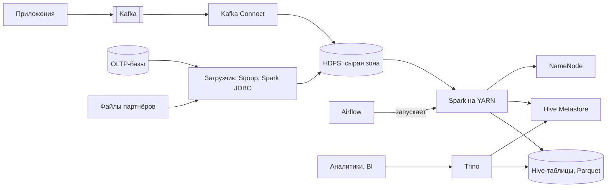

# Глава 14. Batch Data Lake

> **Статус:** 🟨 конспект (собственный разбор, не из книги: числа это допущения)  
> 🎮 [Симулятор этой главы](../../simulator/ch14/index.html)

## 🎯 Одной фразой
Пакетная платформа данных: всё сырое из разных источников складывается в HDFS, ночью Spark превращает его в таблицы Hive и витрины, Airflow держит порядок задач, Trino отвечает аналитикам. Главные решения: **хранить сырое**, **Parquet с партициями по дате** и **задачи, которые можно безопасно перезапустить**.

## 🧭 Карта решения
Требования → оценка (500 ГБ в день, 38 тысяч строк в секунду ночью) → зоны озера → Kafka для событий, загрузчик для таблиц и файлов → HDFS → Spark → Hive Metastore → Trino → формат → партиции → инкремент → идемпотентность → Airflow → качество → мелкие файлы

**Сюжет главы:** задача про объём и порядок, а не про скорость ответа. Число узлов хранения задаёт объём данных, а число узлов Spark задаёт ночное окно.

## 1. Требования и оценка
- Источники трёх видов: события приложений, таблицы боевых баз (OLTP), файлы партнёров.
- Каждую ночь строятся чистые таблицы и витрины; утром аналитики пишут SQL; прошлые дни можно пересчитать.
- Не делаем: дашборды в реальном времени ([глава 15](../15-streaming-pipeline/README.md)), правку отдельных строк ([глава 16](../16-cdc-lakehouse/README.md)).
- NFR: витрины готовы к утру, повтор задачи не портит данные, сырое не теряется, хранение дешёвое.
- 500 млн событий × 1 КБ = **500 ГБ сырого в день**.
- В боевых базах 2 млрд строк, за день меняется 2%: **40 млн строк**. Полный снимок возит в 50 раз больше.
- Ночное окно 4 часа: (500 млн + 40 млн) ÷ 14 400 с ≈ **38 тысяч строк в секунду**.
- Таблицы за год: 500 ГБ × 0,25 (Parquet) × 365 × 3 копии ≈ **137 ТБ**, это 5 узлов по 30 ТБ.

## 2. Данные
- **Сырая зона** `/raw/<источник>/<таблица>/dt=…/`: как пришло, 30 дней.
- **Таблицы** `/dwh/orders/dt=…/`: Parquet со сжатием, партиция по дате.
- **Витрины**: готовые агрегаты под отчёты.
- «Таблица Hive» это каталоги с файлами плюс описание в **Hive Metastore**: колонки, формат, где лежат партиции.

## 3. Архитектура

События идут весь день через Kafka в сырую зону. Ночью загрузчик забирает изменения из реплик боевых баз. Airflow запускает задачи Spark по зависимостям: очистка, проверки, витрины. Trino спрашивает у Metastore, где партиции, и читает Parquet из HDFS.

## 4. Путь решения: проблема → решение → эффект

### Шаг 1. Зачем сырая зона
- **🔴 Проблема:** в расчёте витрины нашли ошибку. Если хранятся только витрины, прошлое не исправить.
- **🟢 Решение:** хранить всё сырое как пришло и строить таблицы из него.
- **⚖️ Цена:** место под сырую зону.

### Шаг 2. Формат файлов
- **🔴 Проблема:** запрос по одной колонке читает JSON целиком, а места уходит вчетверо больше.
- **🟢 Решение:** **Parquet или ORC** со сжатием: читаются только нужные колонки, блоки пропускаются по статистике.
- **⚖️ Цена:** файл не прочитать глазами, схема обязательна.

### Шаг 3. Партиции
- **🔴 Проблема:** почти каждый запрос смотрит на последние дни, а читает весь год.
- **🟢 Решение:** **каталог на дату**. Запрос с условием по `dt` читает только свои каталоги, задача перезаписывает один день.
- **🔀 Чего не делать:** партиция на дату и пользователя даёт миллионы мелких файлов.

### Шаг 4. Как забирать данные из боевой базы
- **Полный снимок:** просто, видит удаления, но возит всё и грузит источник.
- **🟢 Инкремент по `updated_at`:** только изменённое, с реплики, параллельно по диапазонам ключа. Не видит удалений: раз в неделю сверка снимком.
- **CDC:** видит всё и не грузит базу, но это отдельный конвейер ([глава 16](../16-cdc-lakehouse/README.md)).

### Шаг 5. Задачу запустили второй раз
- **🔴 Проблема:** задача упала и перезапустилась, или месяц пересчитывают. `INSERT` задваивает день.
- **🟢 Решение:** **перезапись партиции** (`INSERT OVERWRITE … PARTITION (dt)`), а дата запуска это параметр, а не «сегодня» в коде.
- **🗣️ Для интервью:** «Задача идемпотентна: сколько раз ни запусти за дату, результат один».

### Шаг 6. Кто запускает задачи
- **🔴 Проблема:** cron запускает витрину в 3:00, а загрузка сегодня опоздала. Витрина посчитана по неполным данным, и никто не заметил.
- **🟢 Решение:** **DAG в Airflow**: задача стартует, когда готовы её входы. Сенсоры, повторы, тревога при опоздании к сроку.
- **Чего Airflow не делает:** не обрабатывает данные сам.

### Шаг 7. Качество
- **🔴 Проблема:** партнёр прислал пустые суммы, после выкатки у событий пропал `user_id`.
- **🟢 Решение:** **write-audit-publish**: пишем в скрытую партицию, проверяем число строк, ключи и диапазоны, и только потом показываем.

### Шаг 8. Мелкие файлы
- **🔴 Проблема:** потоковая загрузка и Spark пишут 120 тысяч мелких файлов в день. NameNode держит каждый в памяти (около 1 ГБ на миллион файлов).
- **🟢 Решение:** ночная **компакция** в файлы по размеру блока, запись через `coalesce`.

### Trino или Hive
- **Trino** считает в памяти: секунды, для аналитиков.
- **Hive** пишет промежуточное на диск: минуты, зато переживает сбой узла и любой объём.

## 5. Паттерны
Зоны озера (raw, staging, marts) · Колоночный формат · Партиционирование по дате · Идемпотентные задачи · Оркестрация DAG · Write-audit-publish · Компакция мелких файлов

**Шпаргалки к главе:** [числа для оценки](../../cheatsheets/estimation.md) · [очереди и асинхронность](../../cheatsheets/README.md#очереди-и-асинхронность) · [B-дерево против LSM](../../cheatsheets/theory.md#6-хранилища-b-дерево-против-lsm)

## 6. Вопросы для повторения

Сколько данных и какая нагрузка?

500 млн событий по 1 КБ это 500 ГБ сырого в день. В окно 4 часа это около 38 тысяч строк в секунду. Таблиц за год 137 ТБ с тремя копиями.

Зачем сырая зона?

Чтобы пересчитать таблицы после ошибки или изменения логики.

Чем Parquet лучше JSON?

Колоночный: запрос читает только нужные колонки и пропускает блоки по статистике, данные сжимаются в несколько раз.

По чему партиционировать?

По дате: она есть почти в каждом запросе. Мелкие партиции дают миллионы файлов.

Полный снимок, инкремент или CDC?

Снимок прост, но возит всё. Инкремент дёшев, но не видит удалений. CDC видит всё и не грузит источник, но это отдельный конвейер.

Что такое идемпотентная задача?

Задача перезаписывает свою партицию, а дату получает параметром: повтор даёт тот же результат.

Что делает Airflow и чего не делает?

Запускает задачи по зависимостям, ждёт источники, повторяет упавшее, следит за сроками. Данные сам не обрабатывает.

Чем плохи мелкие файлы?

NameNode держит запись о каждом файле в памяти, а запрос тратит время на открытие тысяч файлов.

Что хранит Hive Metastore?

Описание таблиц и расположение партиций. Его читают Spark, Hive и Trino.

Какое новое требование сломает дизайн?

Свежесть в секунды или правка отдельных строк: нужен поток и табличный формат с обновлениями.

## 7. Мои заметки
- …
