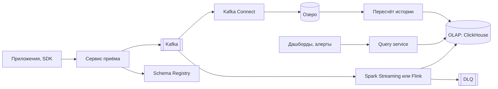

# Глава 15. Streaming Pipeline

> **Статус:** 🟨 конспект (собственный разбор, не из книги: числа это допущения)  
> 🎮 [Симулятор этой главы](../../simulator/ch15/index.html)

## 🎯 Одной фразой
Аналитика в реальном времени: событие приложения через несколько секунд видно на дашборде. Главные решения: **Kafka как шина между приёмом и обработкой**, **ровно один раз по эффекту** (чекпойнты и идемпотентная запись) и **один потоковый код с пересчётом из озера** (Kappa).

## 🧭 Карта решения
Требования → оценка (58 тысяч событий в секунду, пик 174 тысячи) → сервис приёма → **Kafka** → Spark Structured Streaming или Flink → **OLAP** → дашборд; второй потребитель → озеро → надёжная отправка → схема → битые события → event time → exactly-once → триггер → вставка пачками → Kappa

**Сюжет главы:** три требования сразу: скорость, точность и живучесть. Почти каждое решение меняет одно на другое.

## 1. Требования и оценка
- Принимать события; показывать метрики на дашборде за секунды; считать по времени события; складывать копию в озеро; пересчитывать прошлое.
- Не делаем: отчёты за годы ([глава 14](../14-batch-data-lake/README.md)), копию таблиц боевой базы ([глава 16](../16-cdc-lakehouse/README.md)).
- NFR: до 5 секунд от события до дашборда, ни потерь, ни дублей, пик и битое событие не останавливают поток.
- 50 млн пользователей × 100 событий ÷ 86 400 с ≈ **58 тысяч событий в секунду**, пик ×3 ≈ **174 тысячи**.
- 5 млрд событий × 0,5 КБ = **2,5 ТБ в день**; Kafka за 7 дней в трёх копиях: **52,5 ТБ**.
- Запросов дашбордов около 500 в секунду: пишем много, читаем мало.

## 2. API и данные
- `POST /v1/events`: пачка событий, ответ **202** (принято, но ещё не обработано).
- Событие: `event_id`, `event_type`, `user_id`, `ts` (время на устройстве), свойства.
- Топик Kafka, ключ партиции `user_id`.
- OLAP: таблица `events` (для срезов) и `events_1m` (агрегаты по минутам для дашбордов).
- `GET /v1/metrics`: читает агрегаты, а не сырые события.

## 3. Архитектура

Сервис приёма только проверяет и пишет в Kafka. Потоковая задача считает по минутам и пишет пачками в OLAP. Второй потребитель того же топика складывает всё в озеро: оттуда берутся ночные отчёты и пересчёт.

## 4. Путь решения: проблема → решение → эффект

### Шаг 1. Зачем шина
- **🔴 Проблема:** если писать события прямо в базу дашбордов, пик её роняет, а после сбоя события неоткуда перечитать.
- **🟢 Решение:** **Kafka** между приёмом и обработкой.
- **📈 Что улучшилось:** пик копится в журнале; событие читают и поток, и озеро; после сбоя можно перечитать.
- **⚖️ Цена:** ещё один кластер.

### Шаг 2. Не потерять принятое
- **🔴 Проблема:** приложению ответили «принято», а брокер упал до копирования.
- **🟢 Решение:** `acks=all`, минимум две копии в строю, **идемпотентный продюсер** с повторами. Отвечать приложению после подтверждения.

### Шаг 3. Схема событий
- **🔴 Проблема:** одна команда переименовала поле, и ночью сломались все потребители.
- **🟢 Решение:** **Avro или Protobuf и Schema Registry**: несовместимое изменение отклоняется при выкатке.
- **Правило совместимости:** добавить поле с умолчанием можно, переименовать нельзя.

### Шаг 4. Битое событие
- **🔴 Проблема:** задача падает на событии, перезапускается и падает на нём снова: поток стоит.
- **🟢 Решение:** **dead letter queue**: событие с причиной уходит в отдельный топик, поток идёт дальше. На размер DLQ стоит алерт.
- **🔀 Чего не делать:** молча пропускать. Ошибка в разборе тогда выглядит как «событий стало меньше».

### Шаг 5. Какое время считать
- **🔴 Проблема:** телефон был без сети и прислал события через 40 минут.
- **🟢 Решение:** **event time и watermark**: окно закрывается с запасом, совсем поздние учитываются при пересчёте.
- **⚖️ Цена:** результат позже на запас watermark.

### Шаг 6. Ровно один раз
- **🔴 Проблема:** задача записала часть пачки и упала. Offset до записи теряет события, после записи задваивает.
- **🟢 Решение:** **чекпойнт** (offset и состояние вместе) и **идемпотентная запись** по ключу события.
- **🗣️ Для интервью:** «Доставка может повториться, а эффект применяется один раз».

### Шаг 7. Как часто обрабатывать
- **Микробатчи** (Spark Structured Streaming, триггер 1 с): секунды, тот же код работает и в пакете.
- **По событию** (Flink): сотни миллисекунд, сильнее окна и состояние, сложнее в эксплуатации.
- **Пакет раз в минуту:** не реальное время.

### Шаг 8. Запись в OLAP
- **🔴 Проблема:** каждая вставка в ClickHouse создаёт кусок на диске; мелкие вставки заваливают фоновое слияние.
- **🟢 Решение:** писать **пачками** по десяткам тысяч строк.

### Шаг 9. Исправить прошлое
- **Lambda:** поток и пакет рядом. Логика написана дважды, версии расходятся.
- **🟢 Kappa:** один потоковый код; для исправления он прогоняется по событиям из озера.

## 5. Паттерны
Шина событий · Schema Registry · Dead letter queue · Event time и watermark · Чекпойнты · Идемпотентная запись · Микробатчи · Kappa · Backpressure и consumer lag

**Шпаргалки к главе:** [гарантии доставки](../../cheatsheets/theory.md#9-гарантии-доставки) · [потоковая обработка](../../cheatsheets/README.md#потоковая-обработка-event-time-и-watermark) · [повторы и DLQ](../../cheatsheets/README.md#повторы-backoff-и-dlq) · [backpressure](../../cheatsheets/resilience.md#backpressure)

## 6. Вопросы для повторения

Сколько событий в секунду?

50 млн пользователей × 100 событий ÷ 86 400 ≈ 58 тысяч, в пик ×3 около 174 тысяч.

Зачем Kafka между приёмом и обработкой?

Сглаживает пик, даёт несколько независимых потребителей и возможность перечитать после сбоя.

Как не потерять принятое событие?

acks=all, минимум две копии в строю, идемпотентный продюсер. Отвечать приложению после подтверждения.

Зачем Schema Registry?

Хранит версии схем и не пускает несовместимые изменения.

Что такое DLQ?

Топик для событий, которые не удалось обработать: поток идёт дальше, событие не теряется.

Event time или время прихода?

Event time: событие в своей минуте. Watermark задаёт, сколько ждать опоздавших.

Как получить ровно один раз?

Чекпойнт хранит offset и состояние вместе, запись идемпотентна по ключу события.

Spark Structured Streaming или Flink?

Spark: микробатчи, секунды, один код с пакетом. Flink: по событию, миллисекунды, сильнее окна и состояние.

Почему в ClickHouse пишут пачками?

Каждая вставка создаёт кусок на диске. Мелкие вставки заваливают фоновое слияние.

Lambda или Kappa?

Kappa: один потоковый код, пересчёт тем же кодом из озера. Lambda держит логику дважды.

## 7. Мои заметки
- …
