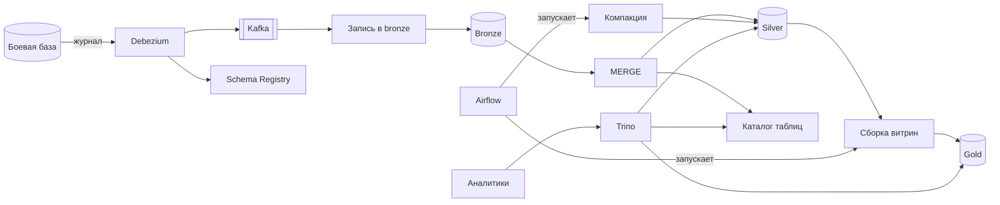

# Глава 16. CDC и Lakehouse

> **Статус:** 🟨 конспект (собственный разбор, не из книги: числа это допущения)  
> 🎮 [Симулятор этой главы](../../simulator/ch16/index.html)

## 🎯 Одной фразой
Актуальная копия таблиц боевой базы в озере с задержкой в минуты: с правками и удалениями и без нагрузки на базу. Главные решения: **CDC из журнала базы**, **ключ события по первичному ключу** и **табличный формат** (Iceberg, Hudi, Delta), который умеет обновлять строки.

## 🧭 Карта решения
Требования → оценка (5 тысяч изменений в секунду, 70% правок) → **Debezium** → Kafka → bronze → **MERGE** → silver → gold → Trino → как захватывать → порядок → начальный снимок → табличный формат → copy-on-write или merge-on-read → компакция → схема → удаления

**Сюжет главы:** копия не должна расходиться с оригиналом. Поток небольшой, трудность в том, чтобы применить каждую правку по порядку и не потерять ни одной.

## 1. Требования и оценка
- Переносить каждую вставку, правку и удаление; держать актуальное состояние таблиц; строить витрины; отвечать на SQL; переживать изменение схемы.
- Не делаем: запросы сайта из озера, запись обратно в базу, реакцию за миллисекунды ([глава 15](../15-streaming-pipeline/README.md)).
- NFR: таблица совпадает с базой, задержка в минуты, база конвейера не замечает, читатель не видит недописанное.
- 5 000 изменений в секунду, пик ×2: **10 тысяч**. Из них 70% это правки и удаления: **7 тысяч в секунду**.
- Журнал изменений: 432 млн × 1 КБ = **432 ГБ в день**.

## 2. Данные
- Событие Debezium: ключ это первичный ключ строки; `op` (c, u, d), `before`, `after`, позиция в журнале.
- Топик на таблицу: `shop.public.orders`.
- **Bronze:** журнал изменений как пришёл, только дозапись.
- **Silver:** по строке на первичный ключ, как в базе.
- **Gold:** витрины.
- Файлы Parquet в объектном хранилище; таблицей их делают метаданные формата.

## 3. Архитектура

Debezium читает журнал базы как реплика и пишет события в Kafka. Поток дописывает их в bronze, задачи MERGE применяют к silver. Airflow по расписанию строит витрины и обслуживает таблицы.

## 4. Путь решения: проблема → решение → эффект

### Шаг 1. Как узнавать об изменениях
- **Двойная запись из приложения:** две записи без общей транзакции. Сбой между ними оставляет системы в разном состоянии навсегда.
- **Опрос по `updated_at`:** не видит удалений, теряет промежуточные версии, грузит базу.
- **🟢 CDC из журнала:** видны все изменения по порядку, база не получает запросов.
- **⚖️ Цена:** база держит журнал, пока коннектор его не прочитал. Отставший коннектор может заполнить диск боевой базы: нужен алерт на отставание.

### Шаг 2. Порядок правок одной строки
- **🔴 Проблема:** заказ за секунду прошёл «создан → оплачен → отменён». Если события попадут в разные партиции, «оплачен» может прийти последним.
- **🟢 Решение:** **ключ партиции это первичный ключ**. В таблице хранится позиция журнала, чтобы старая версия не затёрла новую.

### Шаг 3. С чего начать
- **🔴 Проблема:** в журнале только последние часы, а в таблице 2 млрд строк за пять лет.
- **🟢 Решение:** **начальный снимок**: запомнить позицию журнала, прочитать таблицу целиком, продолжить поток с этой позиции. Стыковка без разрыва.

### Шаг 4. Что такое таблица в озере
- **🔴 Проблема:** таблица Hive это каталог с файлами. Правка переписывает партицию, а запрос во время записи видит её наполовину.
- **🟢 Решение:** **табличный формат**: метаданные знают состав таблицы в каждый момент, запись это атомарная подмена снимка.
- **📈 Что улучшилось:** обновления и удаления строк, чтение без грязных данных, изменение схемы, запрос на прошлый момент.

### Шаг 5. Как применять правки
- **Copy-on-write:** файл с изменённой строкой переписывается целиком. Читать быстро, писать дорого.
- **🟢 Merge-on-read:** правка дописывается в файл изменений, читатель сливает на лету. Писать дёшево, читать дороже до компакции.
- **🗣️ Для интервью:** «Много правок: merge-on-read. Правки редки, а читают часто: copy-on-write».

### Шаг 6. Обслуживание
- **🔴 Проблема:** запись раз в минуту даёт 1440 снимков и тысячи файлов в сутки.
- **🟢 Решение:** по расписанию **компакция** и **удаление старых снимков**.

### Шаг 7. Изменение схемы
- **🔴 Проблема:** в таблицу добавили колонку, задача с зашитой схемой упала.
- **🟢 Решение:** схема в **Schema Registry**, таблица добавляет колонку в метаданные без переписывания файлов.

### Шаг 8. Удаления
- **🔴 Проблема:** строку удалили в базе, а в озере она осталась.
- **🟢 Решение:** событие удаления применяется как `DELETE` по ключу. Физически строка исчезает, когда удалят старые снимки; bronze хранят ограниченное время.

### Когда нужен transactional outbox
В шину должно уйти бизнес-событие («заказ оплачен»), а не слепок строки. Приложение пишет событие в таблицу `outbox` той же транзакцией, что и данные, а CDC читает эту таблицу.

## 5. Паттерны
Change data capture · Transactional outbox · Порядок по ключу · Снимок и поток · Медальон (bronze, silver, gold) · Табличный формат и атомарные снимки · Copy-on-write против merge-on-read · Компакция · Эволюция схемы

**Шпаргалки к главе:** [CDC и outbox](../../cheatsheets/README.md#cdc-и-transactional-outbox) · [изоляция транзакций](../../cheatsheets/theory.md#1-изоляция-транзакций) · [B-дерево против LSM](../../cheatsheets/theory.md#6-хранилища-b-дерево-против-lsm) · [репликация](../../cheatsheets/theory.md#4-репликация)

## 6. Вопросы для повторения

Что такое CDC?

Чтение журнала изменений базы: каждая вставка, правка и удаление становится событием. База при этом не получает запросов.

Чем плоха двойная запись?

Это две записи без общей транзакции. Сбой между ними оставляет системы в разном состоянии.

Почему ключ события это первичный ключ?

Версии строки идут через одну партицию и применяются в порядке базы.

Зачем начальный снимок?

В журнале только недавние изменения. Снимок даёт всю таблицу, поток продолжает с запомненной позиции.

Чем опасен отставший коннектор?

База держит журнал, пока он не прочитан. Журнал может заполнить диск боевой базы.

Чем табличный формат отличается от таблицы Hive?

Метаданные знают состав таблицы на каждый момент. Запись это атомарная подмена снимка.

Copy-on-write или merge-on-read?

Copy-on-write: быстро читать, дорого писать. Merge-on-read: дёшево писать, читать дороже до компакции.

Зачем компакция?

Частые записи плодят мелкие файлы и снимки. Компакция склеивает их, удаление снимков освобождает место.

Удалили строку: что с ней в озере?

DELETE убирает её из текущего снимка. Физически она исчезает, когда удалят старые снимки.

Когда нужен transactional outbox?

Когда в шину должно уйти бизнес-событие, а не слепок строки.

## 7. Мои заметки
- …
