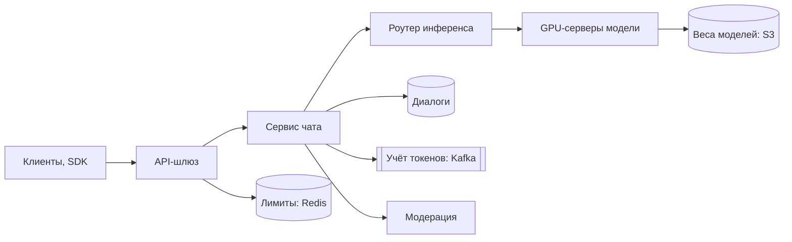

# Глава 17. LLM Inference Service

> **Статус:** 🟨 конспект (собственный разбор, не из книги: числа это допущения)  
> 🎮 [Симулятор этой главы](../../simulator/ch17/index.html)

## 🎯 Одной фразой
Сервис ответов большой языковой модели, как API ChatGPT или Claude: мощность считается **в токенах, а не в запросах**, и почти вся стоимость это GPU. Главные решения: **continuous batching**, **стриминг и время до первого токена**, **лимиты в токенах**, **маршрутизация по кэшу префиксов** и **масштабирование по очереди с тёплым резервом**.

## 🧭 Карта решения
Требования → оценка (7 тысяч запросов в секунду в пик = 2 млн выходных токенов в секунду ≈ 1800 GPU-серверов) → шлюз → сервис чата → **роутер инференса** → **GPU-серверы** → поток ответа; диалоги и учёт токенов сбоку → батчинг → стриминг → лимиты → кэш префиксов → всплеск → очередь → отмена → длинный диалог → сбой узла → модерация

**Сюжет главы:** обычный веб-сервис упирается в запросы в секунду. Здесь запрос живёт секунды, стоит в тысячи раз по-разному, а сервер поднимается минутами. Каждое решение это способ выжать из GPU больше токенов и не заставить человека ждать.

## 1. Требования и оценка
- Отвечать на запрос к модели; отдавать ответ потоком; хранить историю диалога; ограничивать клиентов и считать токены; проверять запросы и ответы.
- Не делаем: обучение моделей, поиск по документам (RAG), картинки и видео.
- NFR: первый токен быстрее секунды, GPU загружены работой, клиенты не мешают друг другу, всплеск и сбой узла не обрывают ответы.
- 10 млн пользователей × 20 запросов ÷ 86 400 с ≈ **2,3 тысячи запросов в секунду**, пик ×3 ≈ **6,9 тысячи**.
- Запрос: 1500 токенов входа, 300 токенов ответа. В пик **2,1 млн выходных** и **10,4 млн входных токенов в секунду**.
- GPU-сервер с батчингом: около 2500 выходных токенов в секунду, входной токен вдесятеро дешевле. 6944 × (300 + 150) ÷ 2500 ÷ 0,7 ≈ **1800 GPU-серверов**.
- Полный ответ: 300 ÷ 50 токенов в секунду = **6 секунд**. Отсюда стриминг.

## 2. API и данные
- `POST /v1/messages` со `stream: true`: ответ по **SSE**, в последнем событии число токенов.
- Ошибки: `429` (кончились токены в минуту, `Retry-After`), `503` (очередь к GPU полна), `400` (не помещается в окно, отклонено модерацией).
- Внутренний вызов GPU-сервера: `prefix_key` (для кэша префиксов), `priority`, `deadline_ms`.
- `messages`: wide-column, ключ раздела `conversation_id`.
- `rate_limits`: корзины токенов в Redis на ключ и организацию.
- `usage_events`: топик Kafka, по нему считается счёт; отдельно `cached_input_tokens`.

## 3. Архитектура

Шлюз проверяет ключ и лимит и держит соединение. Сервис чата без состояния собирает промпт из истории. Роутер выбирает реплику по очереди, памяти и кэшу префиксов. GPU-сервер считает вход и по токену выдаёт ответ, который по той же цепочке идёт клиенту.

## 4. Путь решения: проблема → решение → эффект

### Как модель отвечает
- **Prefill:** один параллельный проход по всему входу. Задаёт время до первого токена.
- **Decode:** проход на каждый выходной токен. Ответ в 300 токенов это 300 проходов.
- **KV-кэш:** промежуточные значения по каждому токену в памяти GPU. Память кончается раньше вычислений.
- **Метрики:** TTFT (время до первого токена), TPOT (время на токен), токены в секунду на GPU.

### Шаг 1. Батчинг
- **🔴 Проблема:** один ответ занимает GPU на секунды. По одному запросу сервер обслуживает одного пользователя.
- **🟢 Решение:** **continuous batching**: пачка пересобирается на каждом шаге генерации, законченный запрос уходит, новый сразу входит.
- **🔀 Альтернатива:** статическая пачка. Короткие ответы ждут самый длинный, новые запросы ждут следующую пачку.
- **⚖️ Цена:** больше пачка, выше пропускная способность, медленнее каждый отдельный ответ.

### Шаг 2. Стриминг
- **🔴 Проблема:** шесть секунд пустого экрана.
- **🟢 Решение:** ответ потоком по **SSE**. Главная метрика теперь время до первого токена.
- **⚖️ Цена:** соединения живут секундами и минутами, учёт идёт по ходу ответа.

### Шаг 3. Лимиты
- **🔴 Проблема:** запрос на 100 тысяч токенов стоит как тысяча коротких, а лимит в запросах этого не видит.
- **🟢 Решение:** **токены в минуту** на ключ и организацию плюс лимит одновременных запросов. Вход списывается сразу, выход резервируется по `max_tokens` и уточняется по факту.

### Шаг 4. Маршрутизация и кэш префиксов
- **🔴 Проблема:** в каждом запросе диалога повторяется системный промпт и история, около 70% входа. Round robin каждый раз отправляет диалог на новую реплику, и вход считается заново.
- **🟢 Решение:** роутер отправляет диалог на реплику, которая уже считала его начало. Привязка с порогом загрузки: выше порога запрос уходит на соседнюю.
- **📈 Что улучшилось:** первый токен быстрее, вход дешевле.
- **Важно:** кэш префиксов это не кэш ответов. Ответ генерируется заново.
- **Правило промпта:** постоянное в начало, меняющееся в конец.

### Шаг 5. Всплеск
- **🔴 Проблема:** новый GPU-сервер поднимается минутами: узел, образ, веса на сотни гигабайт.
- **🔀 Чего не делать:** масштабировать по загрузке GPU. Под батчингом она всегда около 100%.
- **🟢 Решение:** сигнал это **длина очереди и TTFT**; тёплый резерв; подъём заранее по суточному графику; веса на локальных дисках.
- **⚖️ Цена:** резерв стоит денег, прогноз ошибается.

### Шаг 6. Очередь и приоритеты
- **🔴 Проблема:** живые диалоги стоят за пакетными заданиями, а в перегрузку очередь растёт без предела.
- **🟢 Решение:** приоритеты и **ограниченная очередь**: `429` с `Retry-After`, просроченные запросы не считаются.

### Шаг 7. Отмена
- **🔴 Проблема:** около 15% ответов бросают на середине, а GPU продолжает генерировать.
- **🟢 Решение:** закрытое соединение отменяет генерацию по всей цепочке. Списываются выданные токены.

### Шаг 8. Длинный диалог
- **🔴 Проблема:** модель ничего не помнит, историю присылают заново. Вход растёт с каждым сообщением.
- **🟢 Решение:** последние сообщения целиком и короткий пересказ остального.
- **⚖️ Цена:** пересказ теряет детали.

### Шаг 9. Сбой GPU-сервера
- **🔴 Проблема:** половина ответа уже у пользователя, и сервер пропал.
- **🟢 Решение:** сервис чата помнит выданные токены; роутер повторяет на другой реплике, добавив начало ответа к промпту. Тот же идентификатор запроса: токены не списываются дважды.

### Шаг 10. Модерация
- **🟢 Решение:** запрос проверяется быстрым классификатором до большой модели; ответ проверяется кусками параллельно потоку, при нарушении поток обрывается.
- **🔀 Чего не делать:** синхронно проверять каждый кусок. Текст идёт рывками.

## 5. Паттерны
Continuous batching · KV-кэш и PagedAttention · Стриминг по SSE · Token bucket в токенах · Маршрутизация по префиксу · Ограниченная очередь с приоритетами · Масштабирование по очереди · Тёплый резерв · Отмена по обрыву соединения · Каскад моделей

**Шпаргалки к главе:** [повторы и backoff](../../cheatsheets/README.md#повторы-backoff-и-dlq) · [backpressure](../../cheatsheets/resilience.md#backpressure)

## 6. Вопросы для повторения

Почему нагрузку считают в токенах?

GPU тратит время на токены. Запросы отличаются по длине в тысячи раз, поэтому число запросов ничего не говорит о нагрузке.

Что такое prefill и decode?

Prefill: один параллельный проход по всему входу. Decode: проход на каждый выходной токен. Входной токен в разы дешевле выходного.

Чем continuous batching лучше статического?

Пачка пересобирается на каждом шаге: законченный запрос уходит, новый входит сразу. Короткие ответы не ждут длинных.

Какие метрики главные?

Время до первого токена, время на токен и токены в секунду на GPU.

Как работает кэш префиксов?

Реплика хранит KV-кэш начала промпта. Запрос с тем же началом пропускает prefill этой части. Нужна маршрутизация на ту же реплику.

Почему не round robin?

Он не видит ни длины запросов, ни кэша префиксов.

По какому сигналу масштабировать?

По длине очереди и времени до первого токена. Загрузка GPU под батчингом всегда около 100%.

Что делать с холодным стартом?

Тёплый резерв, подъём заранее по суточному графику, веса на локальных дисках.

Что делать при перегрузке?

Ограниченная очередь с приоритетами, 429 с Retry-After, отмена просроченных и брошенных запросов.

Какое новое требование сломает дизайн?

Контекст в миллион токенов или агенты с десятками вызовов: нужен отдельный пул, привязка сессии и долгий кэш префиксов.

## 7. Источники
Собрано по открытым описаниям: [Inside vLLM: Anatomy of a High-Throughput LLM Inference System](https://vllm.ai/blog/anatomy-of-vllm), [KV-cache aware routing в llm-d](https://developers.redhat.com/articles/2025/10/07/master-kv-cache-aware-routing-llm-d-efficient-ai-inference), [Prefix caching](https://bentoml.com/llm/inference-optimization/prefix-caching), [SageServe: forecast-aware autoscaling](https://arxiv.org/pdf/2502.14617). Числа в главе это допущения для расчёта, а не замеры.

## 8. Мои заметки
- …
