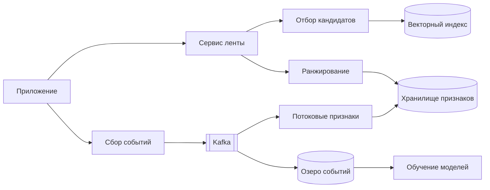

# Глава 18. Recommendation Feed

> **Статус:** 🟨 конспект (собственный разбор, не из книги: числа это допущения)  
> 🎮 [Симулятор этой главы](../../simulator/ch18/index.html)

## 🎯 Одной фразой
Персональная лента, как в TikTok, Дзене или на главной маркетплейса: за 200 мс выбрать двадцать объектов из ста миллионов. Главные решения: **воронка из отбора и ранжирования**, **несколько источников кандидатов и приближённый поиск по векторам**, **feature store со свежими признаками** и **обучение на собственных показах без расхождения с боем**.

## 🧭 Карта решения
Требования → оценка (35 тысяч лент в секунду в пик = 17 млн оценок модели в секунду, 350 тысяч событий) → сервис ленты → **отбор кандидатов** → **ранжирование** → лента; события → Kafka → признаки и озеро → обучение → воронка → источники → ANN → свежесть → skew → показанное → холодный старт → цель модели → деградация → переобучение

**Сюжет главы:** две задачи в одной. Инженерная: уложиться в 200 мс на ста миллионах объектов. И задача про данные: система учится на собственных показах, и ошибка в данных портит ленту незаметно.

## 1. Требования и оценка
- Отдавать персональную ленту; собирать показы и реакции; учитывать действия последних минут; показывать новые объекты и работать для новых пользователей; переобучать модели.
- Не делаем: поиск по запросу, обработку видео, рекламный аукцион.
- NFR: лента быстрее 200 мс, качество не хуже лучшего варианта, действие учтено через секунды, сбой ранжирования не оставляет пустую ленту.
- 100 млн пользователей × 10 запросов ÷ 86 400 с ≈ **11,6 тысячи лент в секунду**, пик ×3 ≈ **34,7 тысячи**.
- 500 кандидатов на тяжёлую модель: **17,4 млн оценок в секунду**, при 20 тысячах оценок на сервер около **1240 серверов ранжирования**.
- 100 событий на пользователя: **347 тысяч событий в секунду** в пик, **2 ТБ в день**.
- 100 млн векторов по 512 байт: **51 ГБ**, индекс помещается в память сервера.

## 2. API и данные
- `GET /v1/feed`: страница из 20 объектов, у каждого `impression_id`.
- `POST /v1/events`: показы, клики, время просмотра пачками, ответ **202**.
- Внутри: `POST /internal/candidates` (отбор) и `POST /internal/rank` (ранжирование).
- `user_features`, `item_features`, `seen`: хранилище ключ-значение.
- `item_vectors`: векторный индекс.
- `topic_events`: Kafka, ключ `user_id`; в событии показа позиция и признаки, с которыми модель приняла решение.

## 3. Архитектура

Прямой путь: сервис ленты вызывает отбор, потом ранжирование, убирает показанное и применяет правила. Обратный путь: события через Kafka становятся свежими признаками и данными для обучения.

## 4. Путь решения: проблема → решение → эффект

### Воронка
| Ступень | Сколько объектов | Что делает |
|---|---|---|
| Отбор кандидатов | 100 млн → 2000 | быстро и грубо, важна полнота |
| Лёгкое ранжирование | 2000 → 500 | простая модель отсекает слабых |
| Тяжёлое ранжирование | 500 → порядок | большая модель, сотни признаков |
| Доранжирование | → 20 | разнообразие, свежесть, фильтры |

### Шаг 1. Каскад
- **🔴 Проблема:** тяжёлая модель на всех кандидатов отбора это вчетверо больше серверов и лишние сто миллисекунд.
- **🟢 Решение:** лёгкая модель перед тяжёлой.

### Шаг 2. Источники кандидатов
- **🔴 Проблема:** что не попало в кандидаты, не попадёт в ленту.
- **🟢 Решение:** несколько источников: **two-tower** с поиском по векторам, подписки, свежее, популярное в регионе.
- **Two-tower:** одна сеть даёт вектор пользователя, другая вектор объекта. Векторы объектов считаются заранее.

### Шаг 3. Поиск ближайших векторов
- **🔴 Проблема:** сравнить вектор пользователя со ста миллионами векторов это секунды.
- **🟢 Решение:** **ANN**: индекс HNSW или IVF находит около 95% настоящих ближайших за миллисекунды.

### Шаг 4. Свежие признаки
- **🔴 Проблема:** человек досмотрел три ролика про ремонт, а признаки пересчитаются ночью.
- **🟢 Решение:** долгие признаки раз в сутки, свежие (последние просмотры, счётчики за час) **потоком** через секунды.

### Шаг 5. Training-serving skew
- **🔴 Проблема:** признаки для обучения считает SQL по озеру, для боя сервис на другом языке. Числа расходятся, офлайн-метрики хорошие, а в бою модель хуже.
- **🟢 Решение:** **feature store** с одним определением признака и **запись признаков при показе**. Для обучения берётся значение на момент показа.

### Шаг 6. Уже показанное
- **🟢 Решение:** **фильтр Блума** на пользователя: несколько килобайт, проверка за микросекунды. Ложное «уже показано» безвредно.

### Шаг 7. Холодный старт
- **🔴 Проблема:** нет показов → нет статистики → модель не выберет → нет показов.
- **🟢 Решение:** вектор нового объекта по содержимому и несколько процентов ленты на **исследование**. Новому пользователю популярное в регионе.

### Шаг 8. Чему учить модель
- **🔴 Проблема:** модель, которая учится на кликах, находит кликбейт.
- **🟢 Решение:** несколько целей (клик, досмотр, лайк, скрытие, жалоба) с весами; веса подбирают A/B по удержанию.
- **Смещение позиции:** верхнее кликают чаще из-за места; позицию учитывают при обучении.

### Шаг 9. Деградация
- **🟢 Решение:** у каждой ступени таймаут и запасной вариант: порядок лёгкой модели, потом популярное. Пустая лента хуже неточной.

### Шаг 10. Жизнь модели
- **🟢 Решение:** ежедневное переобучение; выкатка в тени, потом A/B на доле пользователей, потом на всех. Решают онлайн-метрики.

## 5. Паттерны
Воронка рекомендаций · Two-tower · ANN (HNSW, IVF) · Feature store · Потоковые признаки · Запись признаков при показе · Фильтр Блума · Исследование и использование · Несколько целей · Запасной путь · Теневая выкатка и A/B

**Шпаргалки к главе:** [ИИ-системы](../../cheatsheets/ai-systems.md) · [потоковая обработка](../../cheatsheets/README.md#потоковая-обработка-event-time-и-watermark) · [backpressure](../../cheatsheets/resilience.md#backpressure). Потоковый конвейер разобран в [главе 15](../15-streaming-pipeline/README.md), сервис инференса в [главе 17](../17-llm-inference/README.md).

## 6. Вопросы для повторения

Почему рекомендации делают воронкой?

Точная модель не успевает оценить весь каталог. Дешёвый отбор оставляет тысячи, лёгкая модель сотни, тяжёлая упорядочивает их.

Что такое two-tower?

Две сети: одна даёт вектор пользователя, другая вектор объекта. Близость векторов предсказывает интерес.

Что такое ANN?

Приближённый поиск ближайших векторов: миллисекунды вместо перебора, около 95% настоящих соседей.

Что такое feature store?

Хранилище признаков с онлайн-частью для боя и офлайн-частью для обучения и одним определением признака на обе.

Что такое training-serving skew?

Признаки в обучении и в бою посчитаны по-разному. Лечится одним определением и записью признаков при показе.

Как не показывать одно и то же?

Фильтр Блума на пользователя.

Что делать с новым объектом?

Вектор по содержимому и небольшая доля показов на исследование.

Почему нельзя оптимизировать только клики?

Модель находит кликбейт. Нужны несколько целей и долгая метрика, удержание.

Что делать, если ранжирование не ответило?

Отдать запасной порядок: по лёгкой модели или популярное.

Как выкатывать новую модель?

В тени, потом A/B на доле пользователей, потом на всех. Решают онлайн-метрики.

## 7. Источники
Собрано по открытым разборам: [System Design Interview: Recommendation System](https://www.techinterview.org/post/3233460594/system-design-recommendation-system/), [Design a Recommendation System](https://www.designgurus.io/course-play/grokking-the-ai-system-design-interview/doc/design-a-recommendation-system), [Retrieval and ranking pipelines](https://www.educative.io/courses/grokking-the-machine-learning-system-design-interview/retrieval-and-ranking-pipelines). Числа в главе это допущения для расчёта, а не замеры.

## 8. Мои заметки
- …
