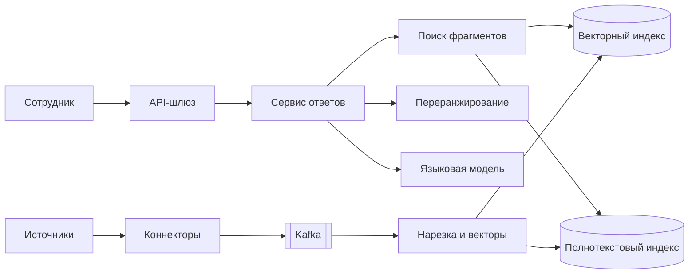

# Глава 19. RAG Assistant

> **Статус:** 🟨 конспект (собственный разбор, не из книги: числа это допущения)  
> 🎮 [Симулятор этой главы](../../simulator/ch19/index.html)

## 🎯 Одной фразой
Ассистент отвечает сотрудникам по документам компании: система **сначала находит нужные фрагменты, потом отдаёт их модели** вместе с вопросом. Главные решения: **нарезка по структуре**, **гибридный поиск и переранжирование**, **права доступа внутри индекса**, **инкрементальная индексация** и **ответ только по источникам**.

## 🧭 Карта решения
Требования → оценка (1700 вопросов в секунду в пик, 1,6 млрд фрагментов, индекс 2,4 ТБ, около 550 GPU-серверов) → шлюз → **сервис ответов** → поиск → **векторный и полнотекстовый индексы** → переранжирование → **языковая модель**; индексация: коннекторы → Kafka → нарезка и векторы → индексы → нарезка → поиск → отбор → права → свежесть → ответ → инъекции → оценка

**Сюжет главы:** RAG выглядит как «найти и передать модели». Ломается он в деталях: плохая нарезка, поиск без точных слов, двадцать фрагментов вместо пяти, утечка прав, устаревший индекс, модель, которая отвечает по памяти.

## 1. Требования и оценка
- Отвечать по документам компании со ссылками; подключать вики, диск, тикеты, почту; показывать только разрешённое.
- Не делаем: дообучение модели на документах, действия в системах, генерацию документов с нуля.
- NFR: первый токен быстрее 2 секунд, ответ опирается на документы, ни одной утечки, изменения видны через минуты.
- 5 млн сотрудников × 10 вопросов ÷ 86 400 с ≈ **580 вопросов в секунду**, пик ×3 ≈ **1700**.
- 200 млн документов × 8 фрагментов = **1,6 млрд фрагментов**, по 1,5 КБ вектор с метаданными: **2,4 ТБ**, это десятки узлов памяти.
- 2% документов меняется в день: **370 фрагментов в секунду** на пересчёт.
- Промпт: 500 токенов инструкции и вопроса + 5 × 400 = **2500 токенов**; модели нужно около **550 GPU-серверов**.

## 2. API и данные
- `POST /v1/ask`: ответ потоком, в конце список источников.
- `chunks`: текст с заголовком раздела, вектор, документ с версией, **группы доступа**; лежит в векторном и полнотекстовом индексах, шарды по компаниям.
- `doc_changes`: топик Kafka с ключом `doc_id` и версией; удаление и смена прав тоже события.
- `answers_log`: вопрос, найденные фрагменты, ответ, оценка пользователя.

## 3. Архитектура

Шлюз определяет группы пользователя. Сервис ответов ищет фрагменты в обоих индексах среди разрешённых, переранжирует, собирает промпт с номерами фрагментов и стримит ответ модели. Индексация идёт отдельно, событиями.

## 4. Путь решения: проблема → решение → эффект

### Шаг 1. Нарезка
- **🔴 Проблема:** один вектор на документ похож на всё сразу; куски по счётчику токенов режут таблицы.
- **🟢 Решение:** резать **по структуре** (заголовки, абзацы, таблицы целиком), с перекрытием, с названием документа и раздела у фрагмента.

### Шаг 2. Гибридный поиск
- **🔴 Проблема:** векторы теряют коды ошибок и номера, BM25 не находит перефразы.
- **🟢 Решение:** оба поиска параллельно, списки сливаются по местам (**Reciprocal Rank Fusion**).

### Шаг 3. Переранжирование и размер контекста
- **🟢 Решение:** **cross-encoder** оценивает 50 кандидатов вместе с вопросом, в промпт идут **5 лучших**.
- **⚖️ Цена:** около 100 мс и свои GPU. Двадцать фрагментов вместо пяти дороже, медленнее и хуже.

### Шаг 4. Права доступа
- **🔴 Проблема:** модель перескажет то, что ей дали, даже чужую зарплату.
- **🟢 Решение:** группы доступа в каждом фрагменте, **фильтр внутри поиска**.
- **🔀 Чего не делать:** фильтровать после поиска: часто не остаётся ничего.

### Шаг 5. Свежесть
- **🟢 Решение:** коннекторы ловят изменения, события через Kafka, пересчёт **только изменённых документов**; удаление тоже событие, версия не даёт старому событию затереть новое.
- **🔀 Альтернатива:** ночная переиндексация: изменения завтра и в сотни раз больше GPU.

### Шаг 6. Ответ по источникам
- **🟢 Решение:** отвечать только по фрагментам, ставить ссылку на каждый факт, говорить «не нашёл».

### Шаг 7. Инъекции в документах
- **🔴 Проблема:** «игнорируй инструкции» в тексте документа.
- **🟢 Решение:** документы как данные в отдельной разметке; права проверены до модели; никаких действий без человека.

### Шаг 8. Оценка качества
- **🟢 Решение:** набор вопросов с правильными документами: **recall@k** поиска, опора и полнота ответа; отзывы и A/B в продакшене.

## 5. Паттерны
Нарезка по структуре · Гибридный поиск и RRF · Cross-encoder · Права в индексе · Инкрементальная индексация через Kafka · Ответ со ссылками · Документы как недоверенные данные · Набор вопросов для проверки

**Шпаргалки к главе:** [ИИ-системы](../../cheatsheets/ai-systems.md#rag-в-двух-словах) · [векторный поиск](../../cheatsheets/ai-systems.md#векторный-поиск-ann). Модель устроена как в [главе 17](../17-llm-inference/README.md), конвейер изменений как в [главе 16](../16-cdc-lakehouse/README.md).

## 6. Вопросы для повторения

Зачем RAG, если можно дообучить модель?

Поиск учитывает права, видит изменения через минуты, забывает удалённое и даёт ссылки.

Зачем гибридный поиск?

Векторы находят перефразы, BM25 коды и имена. Списки сливаются по местам.

Что делает cross-encoder?

Читает вопрос и фрагмент вместе и точно оценивает. Только для 50–100 кандидатов.

Сколько фрагментов отдавать модели?

Около пяти лучших: длинный промпт медленнее, дороже и хуже.

Как учитывать права?

Группы доступа в каждом фрагменте и фильтр внутри поиска.

Как держать индекс свежим?

События изменений через Kafka, пересчёт только изменённых документов, удаления тоже события.

Как сменить модель векторов?

Построить новый индекс рядом, проверить на наборе вопросов, переключить целиком.

## 7. Источники
[Hybrid search and re-ranking in production RAG](https://towardsdatascience.com/hybrid-search-and-re-ranking-in-production-rag), [RAG Architecture in Production](https://dev.to/amasen/rag-architecture-in-production-the-decisions-that-actually-determine-quality-2af), [Production RAG: chunking, retrieval and evaluation](https://towardsai.net/p/machine-learning/production-rag-the-chunking-retrieval-and-evaluation-strategies-that-actually-work). Числа в главе это допущения для расчёта.

## 8. Мои заметки
- …
