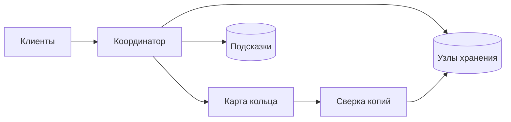

# Глава 20. Key-Value Store

> **Статус:** 🟨 конспект (собственный разбор, не из книги: числа это допущения)  
> 🎮 [Симулятор этой главы](../../simulator/ch20/index.html)

## 🎯 Одной фразой
Само хранилище ключ-значение, как Amazon Dynamo, Cassandra или Riak: **запись принимается всегда**, данные не теряются, кластер растёт добавлением узлов. Главные решения: **consistent hashing с виртуальными узлами**, **кворум N/R/W**, **векторные часы**, **sloppy quorum и hinted handoff**, **деревья Меркла**, **gossip** и **LSM** на узле.

## 🧭 Карта решения
Требования → оценка (10 ТБ, 30 ТБ с копиями, 900 тысяч операций в секунду в пик, 2 млн операций на узлах, около 140 узлов) → клиент → **координатор** → **узлы хранения**; карта кольца, подсказки, сверка → раскладка → кворум → конфликты → временный отказ → постоянный отказ → членство → диск

**Сюжет главы:** задача-сборник. Здесь сходится вся теория распределённых систем: CAP, кворумы, версии, отказы и восстановление.

## 1. Требования и оценка
- `get` и `put` по ключу, значения до 1 МБ, рост без остановки, согласованность на запрос.
- Не делаем: диапазоны ключей, вторичные индексы, транзакции через ключи, SQL.
- NFR: 10 мс, запись принимается при отказах, подтверждённое не теряется, копии сходятся.
- 10 млрд ключей × 1 КБ = **10 ТБ**, с тремя копиями **30 ТБ**: по объёму хватит **22 узлов** по 2 ТБ.
- 300 тысяч операций в секунду, пик ×3 = **900 тысяч**, 80% чтений.
- На узлах: 720 тысяч чтений × R=2 + 180 тысяч записей × N=3 = **1,98 млн операций в секунду** → около **142 узлов**. Кластер упирается в операции, а не в объём.

## 2. API и данные
- `GET /v1/kv/{key}` возвращает значение и **контекст версии**; при параллельных версиях возвращает все.
- `PUT /v1/kv/{key}` принимает контекст: из него строятся новые векторные часы.
- Удаление это **tombstone**.
- На узле: журнал, memtable, SSTable с фильтрами Блума.

## 3. Архитектура

Координатор находит на кольце N узлов ключа, рассылает запрос, ждёт R или W ответов и сравнивает версии. В Dynamo координатором может быть любой узел.

## 4. Путь решения: проблема → решение → эффект

### Шаг 1. Раскладка ключей
- **🔴 Проблема:** `hash mod N` при добавлении узла переносит почти все ключи.
- **🟢 Решение:** **consistent hashing**: новый узел забирает долю только у соседа. **Виртуальные узлы** (сотни точек на сервер) выравнивают нагрузку и размазывают перенос по всем.

### Шаг 2. Кворум
- **🟢 Решение:** N=3, **R=2, W=2**: R+W>N, чтение пересекается с последней записью.
- **🔀 Альтернативы:** R=W=1 даёт устаревшие чтения; R=W=3 отказывает при любой недоступной копии. R и W настраиваются на запрос.

### Шаг 3. Конфликты
- **🔴 Проблема:** last write wins по времени теряет обновления: часы расходятся.
- **🟢 Решение:** **векторные часы**; параллельные версии возвращаются клиенту, он сливает (корзина объединяет товары). **Read repair** чинит отставшую копию при чтении.

### Шаг 4. Временный отказ
- **🟢 Решение:** **sloppy quorum**: запись принимает следующий здоровый узел и хранит **подсказку** «для узла B» (hinted handoff).

### Шаг 5. Постоянный отказ
- **🟢 Решение:** **деревья Меркла**: копии сравнивают корень и спускаются только в разные ветки, по сети идут только разные ключи.

### Шаг 6. Членство
- **🟢 Решение:** **gossip**: раз в секунду узел шлёт карту случайному соседу; детектор отказов помечает молчащих за секунды.

### Шаг 7. Диск
- **🟢 Решение:** **LSM-дерево**: журнал и memtable, SSTable на диске, слияние в фоне, фильтры Блума для чтения.

## 5. Паттерны
Consistent hashing · Виртуальные узлы · Кворум N/R/W · Векторные часы · Read repair · Sloppy quorum и hinted handoff · Деревья Меркла · Gossip · LSM и фильтр Блума · Tombstone

**Шпаргалки к главе:** [кворумы](../../cheatsheets/theory.md#5-кворумы) · [CAP](../../cheatsheets/theory.md#3-cap-и-pacelc) · [B-дерево против LSM](../../cheatsheets/theory.md#6-хранилища-b-дерево-против-lsm) · [Dynamo в шпаргалке кирпичей](../../cheatsheets/building-blocks.md#key-value-хранилище-в-стиле-dynamo) · [consistent hashing](../../cheatsheets/building-blocks.md#consistent-hashing)

## 6. Вопросы для повторения

Зачем виртуальные узлы?

Ровная нагрузка, а перенос при отказе или добавлении узла размазан по всем.

Почему R+W>N?

Множества читающих и пишущих копий пересекаются: чтение видит последнюю запись.

Что такое векторные часы?

Версия как список пар (узел, счётчик): видно, какая версия потомок другой, а какие параллельны.

Что такое hinted handoff?

Запись для недоступного узла хранит сосед и отдаёт, когда узел вернётся.

Зачем деревья Меркла?

Найти расхождения копий, сравнивая хеши, и переслать только разные ключи.

Почему LSM?

Последовательная запись. Чтение спасают фильтры Блума.

Где здесь CAP?

При разрыве сети хранилище выбирает доступность, версии сливаются потом.

## 7. Источники
[Dynamo: Amazon's Highly Available Key-value Store (Википедия)](https://en.wikipedia.org/wiki/Dynamo_(storage_system)), [лекция Princeton по Dynamo](https://www.cs.princeton.edu/courses/archive/spr14/cos461/docs/lec15-dynamo.pdf), [конспект CMU](https://www.andrew.cmu.edu/course/14-848-f18/applications/ln/Dynamo.pdf). Числа в главе это допущения для расчёта.

## 8. Мои заметки
- …
