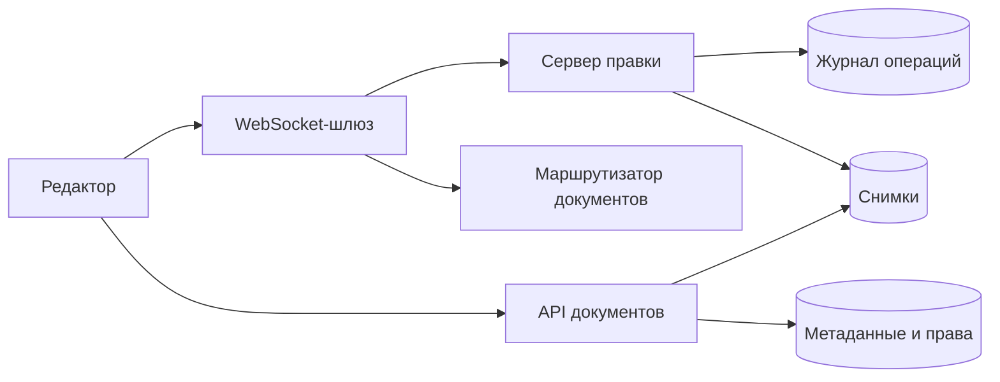

# Глава 21. Collaborative Editor

> **Статус:** 🟨 конспект (собственный разбор, не из книги: числа это допущения)  
> 🎮 [Симулятор этой главы](../../simulator/ch21/index.html)

## 🎯 Одной фразой
Совместная правка документа, как в Google Docs: правки видны соавторам через доли секунды, документ одинаковый у всех, ничего не теряется. Главные решения: **OT или CRDT**, **один сервер на документ**, **WebSocket**, **журнал операций и снимки**, **подтверждение после журнала** и **офлайн-очередь**.

## 🧭 Карта решения
Требования → оценка (1,25 млн редакторов в пик, 1,25 млн операций в секунду, 13 шлюзов, около 180 серверов правки) → редактор → **WebSocket-шлюз** → **сервер правки** → **журнал**; маршрутизатор, снимки, API → сведение правок → дом документа → транспорт → пачки → хранение → подтверждение → офлайн → курсоры

**Сюжет главы:** единственная частая задача, где главное не хранилище, а алгоритм сведения одновременных правок.

## 1. Требования и оценка
- Правка вместе, курсоры, история версий, офлайн, доступ по правам.
- Не делаем: таблицы с формулами, медиа в документе.
- NFR: правка у соавторов быстрее 100 мс, документы сходятся, правки не теряются, открытие быстрее 500 мс.
- 20 млн пользователей × 30 минут ÷ 1440 ≈ **417 тысяч редакторов** одновременно, пик ×3 ≈ **1,25 млн**.
- Шлюзы по соединениям: 1,25 млн ÷ 100 тысяч = **13 шлюзов**.
- Печатают 20% времени, пачка раз в 200 мс: **1,25 млн операций в секунду** → около **180 серверов** правки.
- Журнал: 36 млрд операций в день × 100 байт = **3,6 ТБ в день**.

## 2. API и данные
- `GET /v1/docs/{id}`: снимок, хвост журнала, адрес сервера правки.
- WebSocket `op`: `base_rev`, `client_id`, `seq`, операции; ответ `ack` с новой ревизией; `remote_op` соавторам.
- `ops (doc_id, rev)` в wide-column БД, `snapshots` в объектном хранилище, `documents` с правами в реляционной БД.

## 3. Архитектура

## 4. Путь решения: проблема → решение → эффект

### Шаг 1. Одновременные правки
- **🔴 Проблема:** вставка Анны сдвинула позицию, по которой Борис удаляет символ.
- **🟢 Решение OT:** сервер задаёт единый порядок; операция по старой ревизии **преобразуется против применённых после неё**. Так работает Google Docs.
- **🟢 Решение CRDT:** позиции через неизменные идентификаторы символов, операции коммутируют, сходится без сервера (Yjs, Automerge). Цена: метаданные на каждый символ.
- **🔀 Чего не делать:** сохранять документ целиком (последний затирает остальных) или блокировать документ.

### Шаг 2. Дом документа
- **🟢 Решение:** все соавторы документа на **одном сервере правки**; маршрутизатор по `doc_id` (consistent hashing или аренда в ZooKeeper).

### Шаг 3. Транспорт и пачки
- **🟢 Решение:** **WebSocket**; нажатия за 200 мс склеиваются в одну операцию: впятеро меньше операций.

### Шаг 4. Хранение
- **🟢 Решение:** **журнал операций** с ревизиями и **снимок** каждые 1000 операций. Открытие это снимок и короткий хвост.

### Шаг 5. Сбой сервера правки
- **🟢 Решение:** подтверждать **после записи в журнал**; документ поднимается на другом сервере из снимка и журнала, клиенты досылают неподтверждённое, `client_id` и `seq` защищают от повторов.

### Шаг 6. Офлайн и курсоры
- **🟢 Офлайн:** локальная очередь операций, после возврата догрузить, перебазировать и дослать.
- **🟢 Курсоры:** эфемерно в памяти сервера правки, без журнала.

## 5. Паттерны
Operational transformation · CRDT · Сервер с состоянием на документ · Маршрутизация по ключу · WebSocket · Склейка операций · Журнал и снимки · Подтверждение после записи · Офлайн-очередь

**Шпаргалки к главе:** [консенсус и аренды](../../cheatsheets/README.md#консенсус-raft) · [доставка событий клиенту](../../cheatsheets/building-blocks.md#доставка-событий-клиенту)

## 6. Вопросы для повторения

Как работает OT?

Сервер задаёт порядок; операция по старой ревизии преобразуется против всех применённых после неё.

Чем CRDT отличается от OT?

Операции коммутируют благодаря идентификаторам символов: сходится в любом порядке без сервера, но тяжелее по памяти.

Почему документ живёт на одном сервере?

Единый порядок операций в памяти без блокировок и опроса базы.

Что будет при падении сервера правки?

Документ поднимается на другом сервере из снимка и журнала, клиенты досылают неподтверждённое.

Зачем снимки?

Открытие читает снимок и короткий хвост, а не всю историю.

Где хранить курсоры?

Только в памяти сервера и в рассылке.

## 7. Источники
[Real Differences between OT and CRDT for Co-Editors](https://arxiv.org/pdf/1810.02137), [CRDTs vs Operational Transformation: a practical guide](https://hackernoon.com/crdts-vs-operational-transformation-a-practical-guide-to-real-time-collaboration), [OT vs CRDT (TinyMCE)](https://tiny.cloud/blog/real-time-collaboration-ot-vs-crdt). Числа в главе это допущения для расчёта.

## 8. Мои заметки
- …
