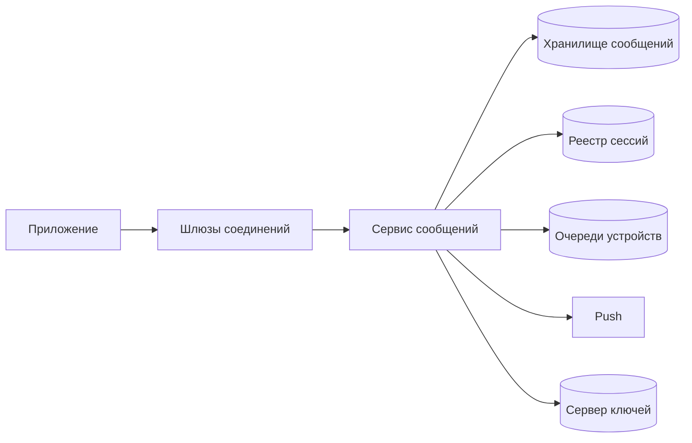

# Глава 22. Messenger

> **Статус:** 🟨 конспект (собственный разбор, не из книги: числа это допущения)  
> 🎮 [Симулятор этой главы](../../simulator/ch22/index.html)

## 🎯 Одной фразой
Мессенджер как WhatsApp или Telegram: сообщение доходит за доли секунды или ждёт в очереди, ничего не теряется и не переставляется, сервер не читает переписку. Главные решения: **долгие соединения**, **реестр сессий**, **номер в чате**, **подтверждения и client_msg_id**, **очередь на устройство**, **раздача групп на сервере** и **сквозное шифрование**.

## 🧭 Карта решения
Требования → оценка (700 тысяч сообщений в секунду в пик, 4,8 млн доставок, 225 млн соединений, 750 шлюзов) → приложение → **шлюз** → **сервис сообщений** → хранилище и **очереди устройств**; реестр сессий, push, ключи → транспорт → маршрут → порядок → подтверждения → офлайн → группы → устройства → шифрование → срок хранения

**Сюжет главы:** пересылка выглядит простой, но проверяют надёжность: как найти получателя, что делать без сети, как не задвоить при повторе и как сохранить порядок.

## 1. Требования и оценка
- Личные чаты, группы до тысячи, галочки, офлайн, несколько устройств, сквозное шифрование.
- Не делаем: звонки, каналы на миллионы, серверный поиск.
- NFR: 200 мс в сети, ни потерь, ни дублей, порядок в чате, сервер не читает.
- 500 млн пользователей × 40 сообщений = **20 млрд в день**, **231 тысяча в секунду**, пик ×3 ≈ **694 тысячи**.
- Группы: 80% × 1 + 20% × 19 = **4,6 получателя** на сообщение, × 1,5 устройства = **4,8 млн доставок в секунду**.
- В сети 30% × 1,5 устройства = **225 млн соединений**, по 300 тысяч на шлюз = **750 шлюзов**.
- 20 ТБ в день, **7,3 ПБ в год**: хранить всё или до доставки решает продукт.

## 2. API и данные
- По одному соединению: `send` с `client_msg_id`, входящие с `seq`, подтверждения `delivered` и `read`.
- `GET /v1/sync`: очередь устройства после офлайна. `GET /v1/keys/{user}`: публичные ключи устройств.
- `messages (chat_id, seq)` в wide-column БД, `inbox (device_id, chat_id, seq)`, `sessions` в Redis, `keys`.

## 3. Архитектура

## 4. Путь решения: проблема → решение → эффект

### Шаг 1. Транспорт
- **🟢 Решение:** одно **долгое соединение** (WebSocket или свой протокол) в обе стороны. Шлюзы тонкие, считаются по соединениям.
- **🔀 Чего не делать:** опрос сервера: задержка, пустые запросы, батарея.

### Шаг 2. Где получатель
- **🟢 Решение:** **реестр сессий** в Redis «устройство → шлюз» с коротким сроком жизни и сердцебиением.

### Шаг 3. Порядок
- **🟢 Решение:** **номер сообщения в чате**, выдаётся атомарно с записью. Клиент видит пропуски.

### Шаг 4. Ни потерь, ни дублей
- **🟢 Решение:** подтверждение на каждом шаге (отправлено, доставлено, прочитано), повтор без подтверждения, **client_msg_id** от дублей.

### Шаг 5. Получатель не в сети
- **🟢 Решение:** сообщение ждёт в **очереди устройства**, телефону уходит **push без текста**.

### Шаг 6. Группы и устройства
- **🟢 Группы:** отправитель шлёт один раз, **сервер раскладывает** копии по очередям; в Signal это sender key.
- **🟢 Устройства:** очередь и ключи **на устройство**.

### Шаг 7. Шифрование и хранение
- **🟢 Шифрование:** **Signal Protocol**: ключи на устройствах, сервер видит шифротекст. Цена: нет серверного поиска и спам-фильтра по тексту.
- **⚖️ Хранение:** вся история (Telegram) или до доставки (WhatsApp): петабайты против терабайтов.

## 5. Паттерны
Долгие соединения · Реестр сессий · Номер в чате · Подтверждения и идемпотентный ключ · Очередь на устройство · Push без текста · Раздача при записи · Сквозное шифрование

**Шпаргалки к главе:** [идемпотентность](../../cheatsheets/README.md#идемпотентность) · [доставка событий клиенту](../../cheatsheets/building-blocks.md#доставка-событий-клиенту) · [рассылка при записи или при чтении](../../cheatsheets/building-blocks.md). Похожая механика соединений в [главе 2](../02-nearby-friends/README.md).

## 6. Вопросы для повторения

Как найти шлюз получателя?

Реестр сессий: при подключении шлюз пишет «устройство → шлюз» с коротким сроком жизни.

Как сохранить порядок?

Номер в чате, выданный атомарно вместе с записью.

Как не потерять и не задвоить?

Подтверждения, повторы и client_msg_id.

Что если получатель не в сети?

Очередь устройства и push без текста.

Как раздать сообщение группе?

Сервер кладёт копию в очередь каждого участника. Для каналов на миллионы нужна раздача при чтении.

Что видит сервер при сквозном шифровании?

Шифротекст и метаданные: кто кому и когда писал.

## 7. Источники
[System Design Case Study: WhatsApp](https://dev.to/mseada/system-design-case-study-whatsapp-k5), [How WhatsApp delivers billions of messages a day](https://dev.to/roni_das_b1b76c5ee6583027/how-whatsapp-delivers-billions-of-messages-a-day-44hg), [WhatsApp case study](https://babushkai.github.io/system-design-patterns/08-case-studies/10-whatsapp). Это пересказы, а не документация WhatsApp; числа в главе это допущения.

## 8. Мои заметки
- …
