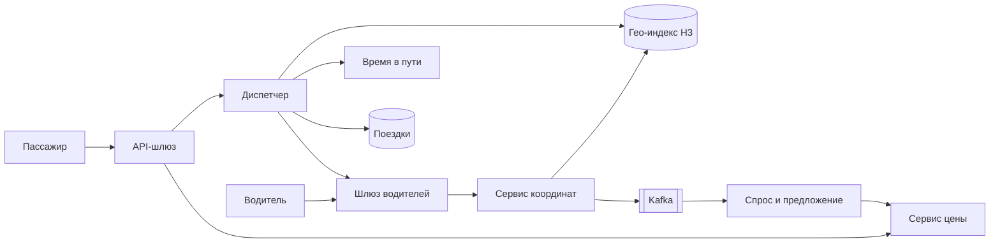

# Глава 23. Ride Matching

> **Статус:** 🟨 конспект (собственный разбор, не из книги: числа это допущения)  
> 🎮 [Симулятор этой главы](../../simulator/ch23/index.html)

## 🎯 Одной фразой
Заказ такси, как Uber или Яндекс Go: за несколько секунд найти водителя, который приедет быстрее всех, не отдать его двум пассажирам и не потерять поездку. Главные решения: **ячейки H3 в памяти**, **подбор по времени подачи**, **атомарная блокировка водителя со сроком**, **динамическая цена из потока** и **поездка как конечный автомат в БД**.

## 🧭 Карта решения
Требования → оценка (250 тысяч координат в секунду и всего 700 заказов в секунду в пик) → водитель → шлюз → сервис координат → **гео-индекс**; пассажир → API → **диспетчер** → индекс, время подачи, предложение, **поездки**; Kafka → спрос → цена → частота координат → индекс → подбор → блокировка → предложение → цена → поездка

**Сюжет главы:** соединяет гео-поиск (глава 1), карты и время в пути (глава 3), потоковый счёт (глава 15) и блокировки (глава 7).

## 1. Требования и оценка
- Координаты водителей, цена и время подачи, подбор, ведение поездки, динамическая цена.
- Не делаем: оплату (глава 11), навигацию (глава 3), совместные поездки.
- NFR: машина за 3 секунды, минимум подачи, ни двойных заказов, ни потерянных поездок, сбой не выходит за город.
- 1 млн водителей ÷ 4 с = **250 тысяч координат в секунду**.
- 20 млн поездок ÷ 86 400 × 3 ≈ **694 заказа в секунду** в пик: в сотни раз меньше координат.
- Цена: 10 запросов на поездку, **6900 в секунду**; время подачи для 10 кандидатов, **6900 расчётов в секунду**.
- Шлюзы водителей: 1 млн ÷ 200 тысяч = **5**.

## 2. API и данные
- Водитель по долгому соединению: `location` раз в 4 с, `offer` с 15 секундами на ответ.
- Пассажир: `GET /v1/quote` (цена фиксируется на 2 минуты), `POST /v1/rides` с ключом идемпотентности.
- `POST /v1/rides/{id}/state` с `expected_version`.
- `driver_cells (h3 → множество)` и `drivers (состояние, lease_until)` в Redis, `rides` в PostgreSQL с шардами по городу, `surge` по ячейкам.

## 3. Архитектура

## 4. Путь решения: проблема → решение → эффект

### Шаг 1. Частота координат
- **🟢 Решение:** раз в 4 секунды: машина проезжает около 50 метров, для подбора хватает. Каждую секунду вчетверо дороже, раз в 30 секунд подбор ошибается.

### Шаг 2. Гео-индекс
- **🔴 Проблема:** 250 тысяч обновлений в секунду реляционная БД не держит, quadtree для движущихся точек постоянно перестраивается.
- **🟢 Решение:** **ячейки H3 в Redis**: ячейка → множество свободных водителей; поиск рядом это своя ячейка и кольцо соседних.

### Шаг 3. Подбор
- **🟢 Решение:** десяток ближайших из индекса, **время подачи по дорогам** с пробками, лучший.
- **🟢 Альтернатива:** **пакетный подбор** раз в пару секунд: меньше суммарная подача ценой ожидания.
- **🔀 Чего не делать:** ближайший по прямой: он может быть за рекой.

### Шаг 4. Один водитель, два заказа
- **🟢 Решение:** атомарный переход «свободен → предложен» (**compare-and-set**) со **сроком 15 секунд**.

### Шаг 5. Водитель молчит
- **🟢 Решение:** срок истёк: блокировка снята, следующий кандидат.

### Шаг 6. Машин меньше, чем людей
- **🟢 Решение:** координаты и заказы в Kafka, **потоковая задача** считает спрос к предложению по ячейкам, сервис цены умножает тариф. Потолок, плавность, цена фиксируется при заказе.

### Шаг 7. Поездка
- **🟢 Решение:** **конечный автомат в БД** с версией и шардами по городу: переходы только разрешённые, повтор не применяется дважды.

## 5. Паттерны
Гео-ячейки H3 · Поиск по кольцу ячеек · Время подачи для top-K · Пакетный подбор · Compare-and-set со сроком · Предложение с таймаутом · Потоковый счёт по ячейкам · Конечный автомат с версией · Шарды по городам

**Шпаргалки к главе:** [геопоиск](../../cheatsheets/README.md#геопоиск-geohash-quadtree) · [блокировки](../../cheatsheets/README.md#оптимистичные-и-пессимистичные-блокировки) · [потоковая обработка](../../cheatsheets/README.md#потоковая-обработка-event-time-и-watermark)

## 6. Вопросы для повторения

Где хранить позиции водителей?

В памяти по ячейкам H3 или geohash: ячейка → множество водителей.

Почему H3?

Шестиугольники: все соседи на одном расстоянии, кольцо ячеек близко к кругу.

Как выбрать водителя?

Десяток ближайших, время подачи по дорогам, лучший; в плотных районах пакетами.

Как не отдать водителя двум заказам?

Compare-and-set «свободен → предложен» со сроком.

Как работает динамическая цена?

Поток координат и заказов, спрос к предложению по ячейкам, коэффициент с потолком.

Как делить систему?

По городам: поездки почти не пересекают границы, сбой не выходит за город.

## 7. Источники
[H3: Uber's Hexagonal Hierarchical Spatial Index](https://www.uber.com/en-US/blog/h3/). Подбор и динамическая цена описаны по общим принципам; числа в главе это допущения.

## 8. Мои заметки
- …
